# ميزان على iPhone Duo — جودة الامتداد الكامل والتكيّف (13 نوفمبر 2026)

نطاق هذه الجولة طبقة العرض فقط: كتلة واحدة في [src/index.css](../src/index.css) (عنوانها «iPhone Duo — الامتداد الكامل والتكيّف»، قبل قسم «وضع المحكّم وسماته»)، واسم صنف واحد `mizan-judge-wait` على شاشة انتظار المحكّم في [JudgeOS.tsx](../src/components/judge/JudgeOS.tsx). لم يُمَسّ نصّ المصحف ولا مصادره، ولا الدرجات، ولا القرعة، ولا عدالة التحكيم، ولا المصادقة، ولا Firestore، ولا الخادم، ولا ملفات النشر.

رموز الحالة: `PASS` تحقق مُشاهد/مُختبر، `PARTIAL` جزئي، `FAIL` خلل باقٍ، `BLOCKED` يحتاج جهازًا أو إذنًا، `NOT_APPLICABLE` غير ذي صلة، `NOT_TESTED` لم يُختبر.

ملاحظة على المرجع: ملف التعليمات الرئيسي `~/Desktop/00_MASTER_CLAUDE_CODE_AR.txt` لم يكن موجودًا على الجهاز وقت العمل. اتُّبعت تعريفات الوضعيات A–J كما طبّقتها جلسة أوربت في الجولة نفسها، ومعايير `~/duo-work/DUO_BRIEF.md`.

## 1. ما كان موجودًا قبل هذه الجولة

جولات سابقة على `main` عالجت الكثير: قمرة المحكّم بلوحين من 600px (#409)، والمطوي (#405، #410)، وشريط الأقسام الثماني من 760px (#411)، وحارس تكبير iOS للحقول (#415)، و`viewport-fit=cover` وحواف الأمان للأشرطة الثابتة. لم يُعَد بناء أيٍّ منها.

## 2. خط الأساس قبل التعديل (`origin/main`)

| الفحص | النتيجة |
|---|---|
| `npm ci` | PASS |
| `secret-scan` و`source-audit` و`production-audit` | PASS |
| `npm run lint` (`tsc --noEmit`) | PASS |
| `npm test` | 2873 نجح، وفشل واحد سابق: `tests/quran-tayseer-resegmentation.test.ts` («the build reproduces every committed artifact byte for byte»، بصمة `al-duri-abu-amr` لا تطابق). يفشل محليًا قبل أي تعديل، وCI على `main` أخضر. لا علاقة له بطبقة العرض، ولم يُلمس |
| `npm run build` | PASS |
| مصفوفة WebKit (12 مقاسًا × 9 شاشات = 108) | لا تمرير أفقي، ولا عناصر خارج الشاشة، ولا أهداف لمس دون 44px. الخطآن في 404 المطوي اتصالُ Firestore المحلي بلا شبكة، لا خطأ عرض |

## 3. ما وُجد وما أُصلح من جذوره

| # | العَرَض (قبل) | الجذر | الإصلاح |
|---|---|---|---|
| 1 | المطوي العرضي 594×368: الترويسة (مع سطر اسم المسابقة) تبقى ملتصقة بارتفاع 98px، أي 27% من الشاشة طوال التمرير. وفي المفتوح العرضي مع لوحة مثبّتة 951×350: الترويسة 64px + شريط العرض 46px = 110px من 350 | `.mz-el-header` لاصق (`sticky top-0`) في كل الارتفاعات | `@media (orientation:landscape) and (max-height:480px)`: الترويسة تجري مع الصفحة وتعود بالتمرير إلى أعلى، كما تنسحب الأشرطة في size class «مضغوط عموديًا». الأشرطة الثابتة نزلت من 98 إلى 0 (594×368) ومن 110 إلى 45 (951×350، شريط البيئة التجريبية وحده). قمرة المحكّم تقيس موضعها من أعلى المستند (`measureTop`)، فارتفاعها لم يتغيّر |
| 2 | 594×368 لمدير المسابقة: شريط الأقسام الثمانية كتلة 4×2 بارتفاع ~215px قبل أول سطر من المحتوى | قاعدة الأعمدة الثمانية تبدأ من 760px فقط | `(min-width:560px) and (max-width:759.98px) and (max-height:480px)`: صفّ واحد بثمانية أعمدة متساوية، 48px لكل زر. كل التسميات ظاهرة بلا اقتطاع |
| 3 | كل `min-h-screen` (أكثر من 20 موضعًا) و`body{min-height:100vh}`: في Safari الـ`100vh` هو الارتفاع الأكبر، فيزيد على المرئي بقدر شريط العنوان ويُحدث تمريرًا فارغًا | وحدة الارتفاع | `@supports (height:100dvh)`: `min-h-screen` و`h-screen` و`body` على `100dvh`. المتصفّح القديم يبقى على `100vh` |
| 4 | وضع الكتاب (مفصل عمودي x=334): بطاقة الدخول كلها تعبر المفصل (حقلا البريد وكلمة المرور، «دخول»، «نسيت كلمة المرور؟»، «جرّب النسخة التجريبية») | لا تحسين تدريجي لـ Viewport Segments | `@media (horizontal-viewport-segments:2)`: البطاقة كاملة في الجزء الأيمن (بداية القراءة) بحشو مأخوذ من `env(viewport-segment-left 1 0)`. العبور: 5 ← 0 |
| 5 | وضع الكتاب: قمرة المحكّم عمودها `minmax(0,1fr) clamp(248px,34vw,344px)`، فيقع خط الطي داخل الورقة (نصّ المصحف) ويعبره «إعادة الفحص» ومقبض بيانات الجلسة | الأعمدة لا تعرف المفصل | الورقة = `env(viewport-segment-width 1 0)` واللوحة = `env(viewport-segment-width 0 0)`، والفاصل = عرض المفصل بالضبط. شريط البيانات فوق الورقة وحدها، والمقبض في منتصفها. مع مفصل 12px: اللوحة 0–328 والورقة 340–669. العبور: 2 ← 0. ونسخة `[dir="ltr"]` للإنجليزية |
| 6 | وضع الكتاب: زرّ «ابدأ مع المتسابق التالي» في منتصف شاشة الانتظار، على المفصل | تخطيط عمودي واحد في المنتصف | صنف `mizan-judge-wait`: الشاشة في الجزء الأيمن بعرضه. العبور: 1 ← 0 |
| 7 | وضع الطاولة (مفصل أفقي y=334، 951×669): الورقة واللوحة جنبًا إلى جنب بارتفاع كامل، فيشطر المفصل سطور المصحف | الصفوف لا تعرف المفصل | `@media (vertical-viewport-segments:2)`: الورقة فوق المفصل بارتفاع الجزء العلوي ناقصًا الترويسة، ولوحة المفاتيح تحته على النصف المسنود، والفاصل = المفصل. ولأن اللوحة صارت نصف الارتفاع بعرض الشاشة (ملاحظة مراجعة Codex على #419): ثلاثة مفاتيح في الصف وأرضية 48px للصف، فيُمرَّر الفائض ولا تتراكب المفاتيح. تحقق أثناء التحكيم: 6 مفاتيح × 74px، صفر تراكب |

دون Viewport Segments (Safari 27.1 الافتراضي) لا تُطبَّق الكتل 4–7 أبدًا، ولا يتغيّر بكسل.

## 4. فحص الامتداد الكامل

| البند | الحالة | الدليل |
|---|---|---|
| خلفية الجذر | PASS | `html` و`body` يحملان `--canvas`، والشاشات الداكنة (القمرة، القاعة) ممتدة حافة لحافة. لم تتغيّر |
| `viewport-fit=cover` وحواف الأمان | PASS (مراجعة كود) | موجود في [index.html](../index.html)، والأشرطة الثابتة (شريط العرض، القمرة، القاعة) تأخذ `env(safe-area-inset-*)`. Playwright يعطي الحواف صفرًا دائمًا، فالقيم غير المتماثلة لم تُقَس |
| تمرير أفقي | PASS | 0 في 108 حالة (WebKit) وفي محاكاة المفصل (Chromium) |
| التكبير | PASS | لا `user-scalable=no` ولا `maximum-scale` |
| لوحة المفاتيح | NOT_TESTED | المحاكاة لا تُظهر لوحة مفاتيح حقيقية |

## 5. مصفوفة الوضعيات A–J

المنصة: Playwright WebKit (build 2370) بملف Safari المحمول (UA iPhone، لمس، DPR 2، تقليل الحركة) لـ A–D وG–H؛ وChromium عبر CDP `Emulation.setDeviceMetricsOverride.displayFeature` لـ E–F. الشاشات: الدخول، المتسابق، المحكّم، رئيس اللجنة، مدير المسابقة، مدير الجهة، البثّ، شاشة فارغة (مالك المنصة بلا بيانات خادم)، شاشة خطأ (مسابقة غير موجودة).

| الوضعية | المقاس | النتيجة | الحالة |
|---|---|---|---|
| A مطوي طولي | 382×580 | 9 شاشات بلا تمرير أفقي ولا هدف صغير. القمرة تبدأ بالمصحف | PASS (محاكاة) |
| B مطوي عرضي | 594×368 | الترويسة لم تعد لاصقة، والأقسام صفّ واحد | PASS (محاكاة) |
| C مفتوح طولي | 669×880 | القمرة بلوحين، والصفحات عمود واحد مريح | PASS (محاكاة) |
| D مفتوح عرضي | 951×600، و951×350 مع لوحة مثبّتة | ✓، والأشرطة على 951×350 من 110 إلى 45px | PASS (محاكاة) |
| E كتاب | 669×880 + مفصل x=334 (0 و12px) | الدخول وشاشة الانتظار وقمرة المحكّم: لا عبور. صفحات الإدارة والمتسابق (عمود واحد يتدفّق) ما زال فيها عنصر يعبر: «عرض النتيجة»، و«الإعدادات»، وتبويبات الأقسام | PARTIAL: الشاشات الحرجة PASS في **محاكاة Chromium**. وعلى الجهاز BLOCKED: الـ API خلف علم في Safari 27.1 |
| F طاولة | 951×669 + مفصل y=334 | القمرة: الورقة فوق، المفاتيح تحت. الدخول: حقل البريد يعبر المفصل (البطاقة أطول من نصف الشاشة) | PARTIAL (محاكاة Chromium)، BLOCKED على الجهاز |
| G نافذتان | 385×571 | ✓ | PASS (محاكاة) |
| H Split | 320 / 470 / 620 ×600 | ✓ | PASS (محاكاة) |
| I خيمة/حامل | — | لا runtime يعلن هذه الوضعية، ولا يُدَّعى اكتشافها | NOT_TESTED |
| J انتقال حي | 951→669→470→382→594×368→951 دون إعادة تحميل، أثناء جلسة تحكيم | عقدة `.mizan-judge-os` هي نفسها في كل خطوة، وعدّاد الجلسة استمر (00:03 ← 00:10)، والأعمدة تبدّلت (لوحان ← عمود ← لوحان)، ولا تمرير أفقي ولا خطأ | PASS لاستمرار الجلسة |

مقاسات إضافية: iPhone 393×852 و1440×900. كلاهما بلا تمرير أفقي ولا خطأ.

### الصوت أثناء تبدّل التخطيط

- التعديل CSS فقط، ولا يوجد في شجرتي المحكّم والمتسابق أي `matchMedia` أو `innerWidth` يبدّل المكوّنات حسب العرض. الأثر الوحيد لتغيير الحجم هو إعادة قياس `measureTop`. فالمسجّل (`recorderRef`) وتيار الميكروفون (`streamRef`) في `JudgeOS` لا يُعاد تركيبهما. ثبتت هوية العقدة في J.
- **تسجيل حقيقي أثناء التبدّل: NOT_TESTED.** سياسة مسابقة العرض لا تطلب تسجيل الصوت، فالقمرة لا تفتح الميكروفون فيها (0 استدعاء لـ`getUserMedia` مع ميكروفون وهمي في Chromium). ومسار التدرّب للمتسابق يحتاج حزم المصحف، وهي غير موجودة في العرض عمدًا.

## 6. صور قبل/بعد (في [iphone-duo/](iphone-duo/))

| الحالة | قبل | بعد |
|---|---|---|
| B مطوي عرضي، مدير المسابقة | 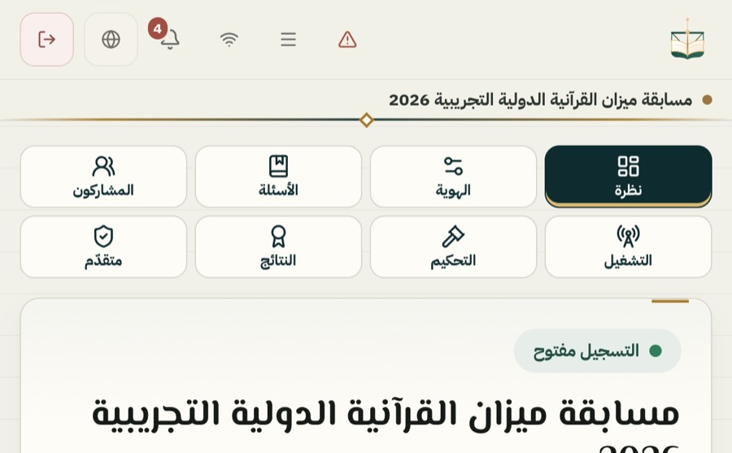 | 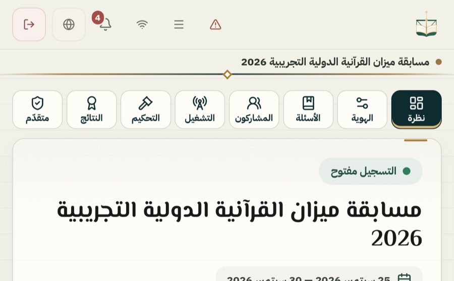 |
| D 951×350، المتسابق | 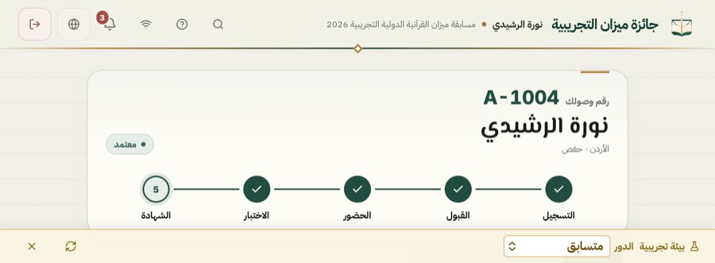 |  |
| E كتاب، الدخول | 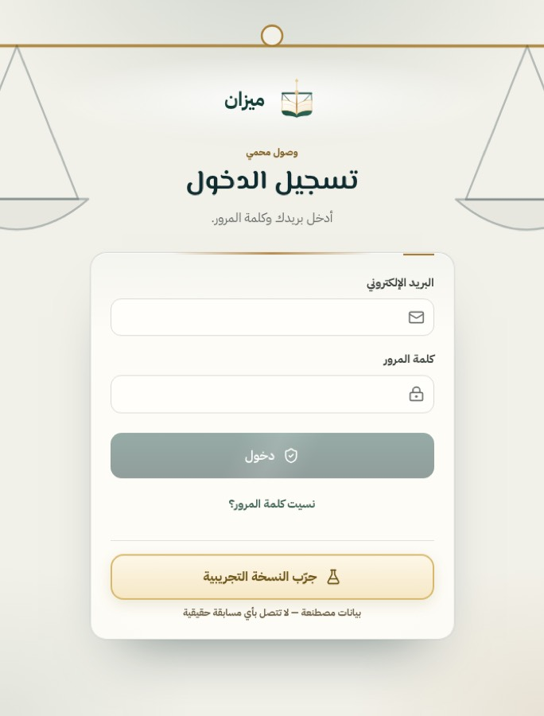 | 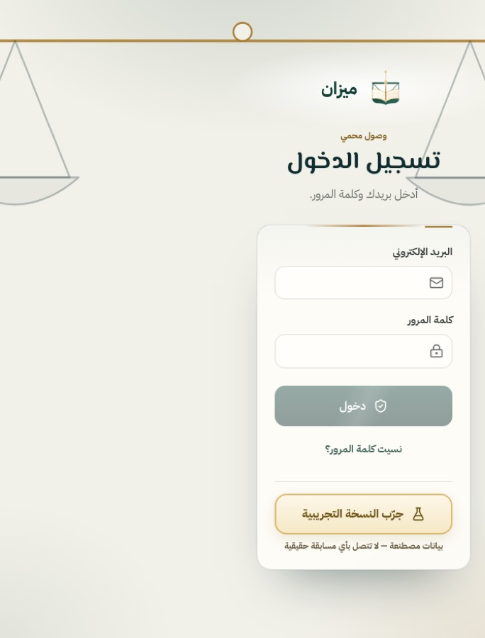 |
| E كتاب، انتظار المحكّم | 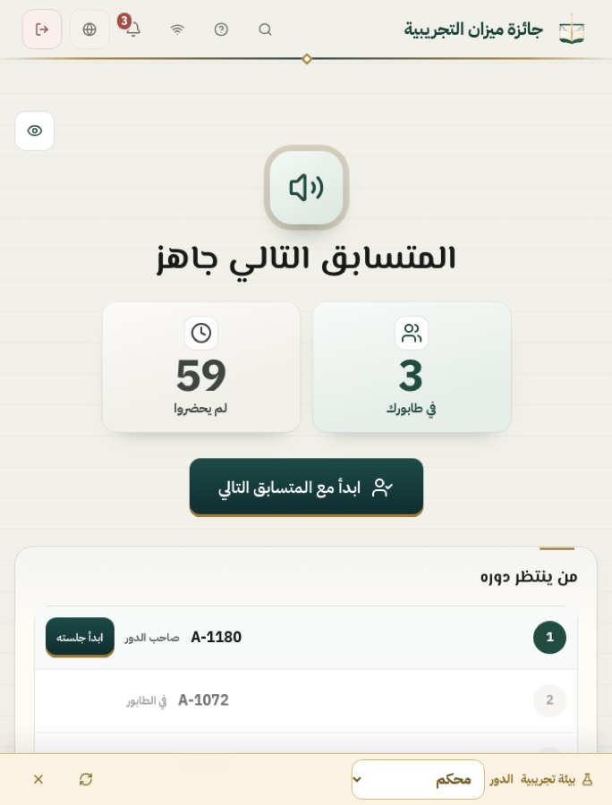 | 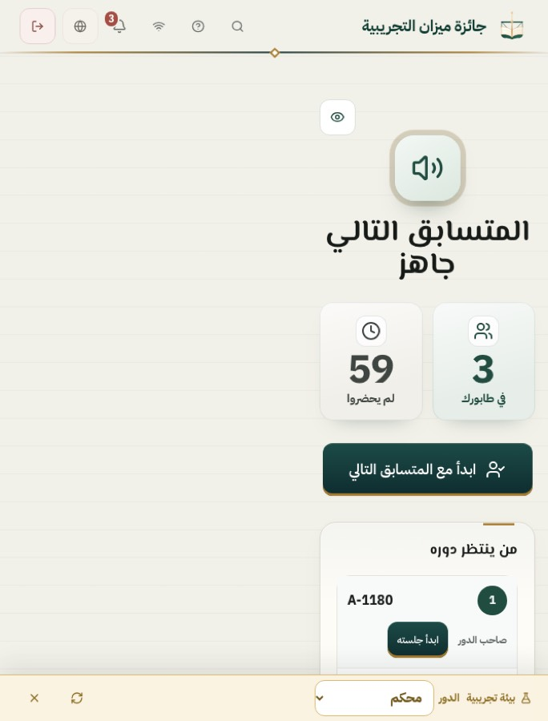 |
| E كتاب، قمرة المحكّم | 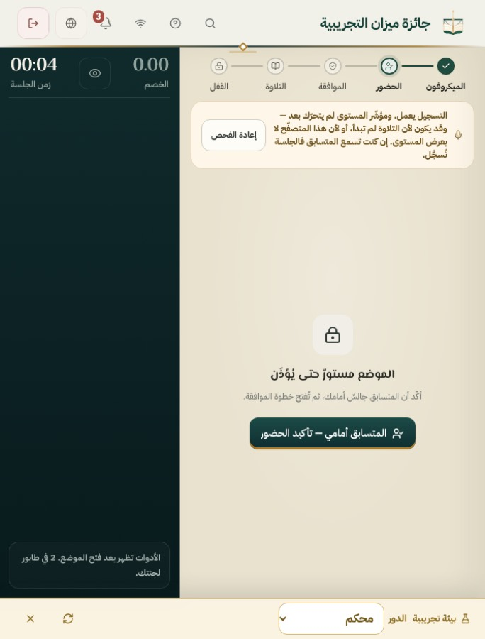 | 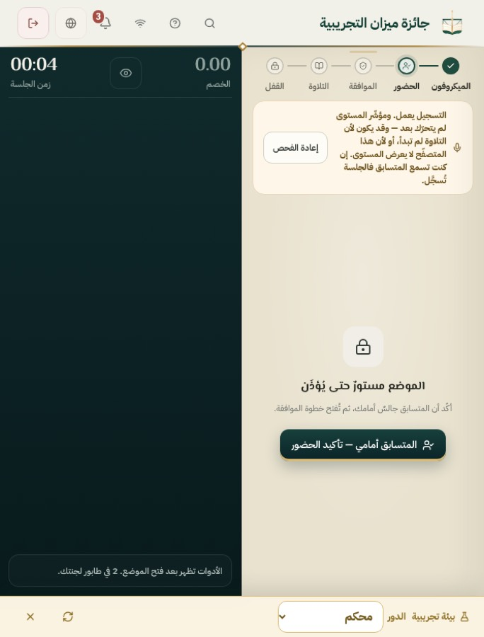 |
| F طاولة، قمرة المحكّم | 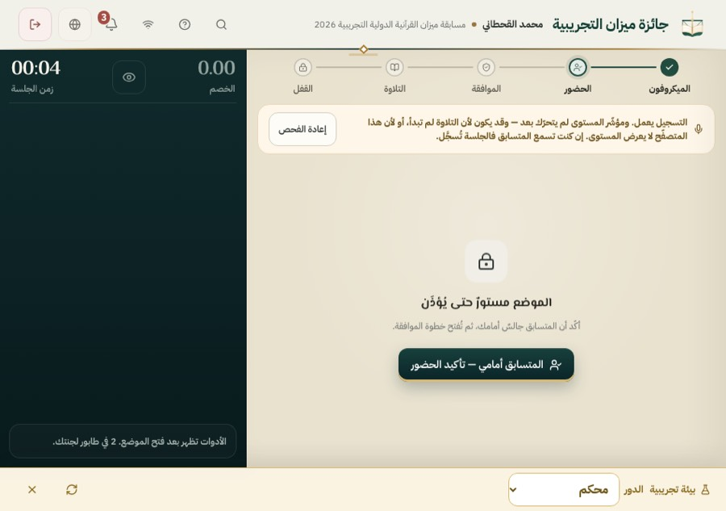 | 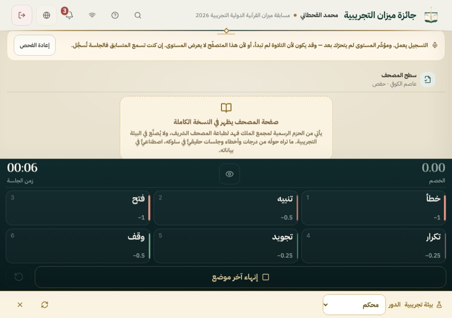 |

بعد فقط: [A مطوي، المحكّم](iphone-duo/A-folded-judge-after.jpg)، [C مفتوح طولي، الإدارة](iphone-duo/C-open-portrait-compadmin-after.jpg)، [D مفتوح عرضي، مدير الجهة](iphone-duo/D-open-landscape-orgadmin-after.jpg)، [A خطأ](iphone-duo/A-folded-error-after.jpg)، [H 470 شاشة فارغة](iphone-duo/H-split-470-empty-after.jpg)، [J 382 أثناء جلسة](iphone-duo/J-transition-382-judge-session.jpg).

## 7. ما يجب فحصه على iPhone Duo حقيقي

1. مطوي عرضي (Safari): الترويسة تختفي بالتمرير وتعود عند الأعلى، وشريط الأقسام صفّ واحد.
2. قمرة المحكّم مع مسابقة تطلب تسجيل الصوت: ابدأ التسجيل، ثم افتح الجهاز واطوه وانتقل إلى Split وعُد. يجب أن يبقى التسجيل مستمرًا وأن يُحفظ الملف كاملًا.
3. إن فُعّل علم Viewport Segments في Safari: وضع الكتاب (الدخول، الانتظار، القمرة) ووضع الطاولة (القمرة).
4. حواف الأمان الفعلية حول الكاميرا في الشاشتين.

## 8. ما بقي مفتوحًا

- E وF لصفحات الإدارة والمتسابق: العمود الواحد ما زال يعبر المفصل (`PARTIAL`). الحل الكامل أن يكون لكل صفحة تخطيط بجزأين، وهذا أكبر من هذه الجولة.
- اختبار `quran-tayseer-resegmentation` يفشل محليًا قبل التعديل وبعده، وCI أخضر. يستحق فحصًا مستقلًا لبيئة بناء المصادر.
- النشر: سير «نشر ميزان إلى Cloud Run» يدوي فقط (`workflow_dispatch`)، ولا يعمل عند الدمج.
