# ميزان على iPhone Duo — القبول النهائي: صفحتا الكتاب ومصفوفة الوضعيات الكاملة (14 نوفمبر 2026)

هذه الجولة تبني على [IPHONE-DUO-ADAPTIVE-QUALITY.md](IPHONE-DUO-ADAPTIVE-QUALITY.md) (#419) ولا تعيد ما حُلّ فيها. نطاقها طبقة العرض فقط: CSS في كتلة iPhone Duo من [src/index.css](../src/index.css)، ومكوّنٌ عرضيّ واحد [Spread.tsx](../src/components/layout/Spread.tsx)، وأسماء أصنافٍ وسمة `data-duo="aside"` على جذور الصفحات. **لم يُمسّ** التحكيم ولا الدرجات ولا مصادر القرآن ولا القرعة ولا تسجيل الصوت ولا المصادقة ولا Firestore ولا الخادم ولا ملفات النشر ولا CI.

رموز الحالة: `PASS` مُقاس بلا خلل · `PARTIAL` يعمل وفيه ملاحظة مسمّاة · `FAIL` خلل باقٍ · `BLOCKED` يحتاج جهازًا أو بيانات غير متاحة · `NOT_TESTED` لم يُختبر. **لا شيء هنا اختُبر على جهاز iPhone Duo حقيقي.**

## 1. المشكلة والتصميم

على الشاشة الداخلية كانت كل صفحة صفحةَ هاتفٍ ممدودة: العنوان والبطاقات والأزرار تمرّ فوق خطّ الطيّ. القياس على `origin/main` (الأساس): **81 من 81** خليةً داخلية فيها عنصرٌ يقع على منطقة الكعب، بمجموع **901** عنصرٍ (نص أو زرّ أو حقل).

الحلّ: **صفحتان لا صفحةٌ ممدودة**.

- **متى**: من مساحة النافذة لا من نوع الجهاز، لأن Safari لا يكشف المفصل: عرض 640–760 طوليًّا بارتفاع ≥ 520 (كتاب طولي 669×867 ونصفه 669×520)، أو عرض 640–1000 عرضيًّا بارتفاع 520–720 (كتاب عرضي 951×585). الآيباد (768×1024، 1024×768) والهاتف والحاسوب خارج الشرط فلا يتغيّر فيها بكسل.
- **الكعب**: 28–36px في المنتصف (`--duo-spine`)، خطٌّ شعريّ وظلُّ طيٍّ خفيف، والخلفية متّصلة حافةً لحافة. يُرسم فقط حين تكون على الشاشة صفحةٌ بورقتين.
- **الورقتان**: ورقة العمل يمنى (بداية القراءة بالعربية)، وورقة السياق يسرى. كل ورقة تنتهي قبل الكعب بهامش `--duo-gutter`، فلا نصّ ولا زرّ ولا حقل ولا عمود جدول على الطيّ.
- **بلا JavaScript للتخطيط**: `Spread` يوزّع الأبناء على ورقتين بحسب `data-duo="aside"` مرّةً واحدة، والتخطيط بعدها CSS خالص. خارج مقاس الكتاب تبقى الورقتان كتلتين متتاليتين بالتباعد نفسه وبترتيب المصدر. **تغيير المقاس لا يعيد تركيب أي مكوّن**، فالتسجيل والتشغيل والحقول والنوافذ تبقى (القسم 6).

| الشاشة | ورقة العمل (يمنى) | ورقة السياق (يسرى) |
|---|---|---|
| الدخول، استعادة كلمة المرور | بطاقة الدخول | العلامة والعنوان تحت محور الميزان |
| انتظار المحكّم | «المتسابق التالي جاهز» وزرّ البدء (مثبّت) | الطابور وتفاصيل الكشف |
| قمرة المحكّم | الورقة (المصحف) | لوحة المفاتيح؛ الكعب بينهما بلون القمرة |
| المتسابق | حالة اليوم (دورك/استعدادك/سجلّك) | الهوية وخطوات الرحلة والتبويبات |
| مدير المسابقة (8 أقسام) | القسم المفتوح | فهرس الأقسام عمودًا واحدًا كفهرس كتاب، مثبّت |
| رئيس التحكيم | المراجعة/الاعتراض المفتوح | العنوان والتبويبات وبلاغ الاستمرارية |
| مركز العمليات | لوحة الحالات وأقسام التدفق | بطاقة «حالات تحتاجك» |
| البوابات (الجهة، الوفد، التدقيق، الاستثناءات، وليّ الأمر، الدعم، غرفة القيادة، المشغّل) | المحتوى | العنوان (صفحة افتتاح بخط ذهبي) والأرقام والتبويبات |
| النوافذ (Modal، الإشعارات، البحث السريع) | النافذة بعرض الصفحة اليمنى | الستار يغطي الاثنتين |
| «اشرح لي هذه الواجهة» | — | الدليل ورقةٌ فوق الصفحة اليسرى |
| شاشة البثّ (الحفل) | المشهد | الترويسة والتذييل نصفان |
| الدليل العام، الجواز، الواجهة التسويقية | القوائم والبطاقات | العنوان والبحث؛ أقسام التسويق عمودان بينهما الكعب |

- **الورقة الضيّقة** (~290px في الكتاب الطولي): المكوّنات تبدّل تخطيطها بعرض الشاشة (`sm:` من 640px) فترى 669 «واسعة» وهي في ورقةٍ بعرض هاتف. استعلام حاوية (`@container mz-leaf`) يعيد داخل الورقة وحدها صفوف «عمودي على الهاتف» وأعمدة الشبكات وحشوها، ويلفّ صفوف الأزرار بدل أن تخرج.
- **وضع الحاسوب المحمول** (951×350، 600×350، 594×368، وآيفون عرضي 844×390): المحتوى فوق والأدوات تحت اليد. شريط أقسام المسابقة الثمانية، وتبويبات ورقة السياق (المتسابق، رئيس التحكيم، غرفة القيادة) تصير شريطًا سفليًّا ثابتًا بارتفاع ~52px، ويُحجز مكانه أسفل الصفحة فلا يغطي سطرًا، ويقف فوق شريط بيئة العرض حين يكون مثبّتًا. الترويسة تنسحب بالتمرير كما في #419.
- **المطويّ** (382×580، 385×571، 320×568): مهمة واحدة واضحة والخلفية ممتدة؛ لم يتغيّر فيه شيء عن #419 سوى إصلاحات أهداف اللمس (القسم 8).
- **المفصل الحقيقي** (اختياري ومعزول): مع `horizontal-viewport-segments:2` يأخذ الكعب عرض المفصل `env(viewport-segment-*)`، وقواعد القمرة المقاسة بالمفصل من #419 تأتي بعد كتلة الكتاب فتغلبها. أُزيلت قاعدتا المفصل الخاصتان بالدخول وانتظار المحكّم لأن الصفحتين تغنيان عنهما.
- **الهوية**: الخطوط والألوان والرموز كما في النظام؛ لا زجاج ثقيل ولا حركة متكرّرة ولا احتفال؛ تقليل الحركة محترم (لا حركة جديدة أصلًا).

## 2. جرد الشاشات

الجرد مستخرج من الموجّه والتنقّل، لا عيّنة:

- **الموجّه** ([App.tsx](../src/App.tsx)): الدخول، `#reset-password`، `#competition` و`#register` و`#journey` و`#guardian` (تحتاج مسابقةً منشورة)، `#discover`، `#passport`، `#manage-competition` (مدير الجهة)، الواجهة التسويقية (مضيف `mizan.*`)، وحالة «مسابقة غير موجودة».
- **الأدوار** (`roleView` + شريط البيئة التجريبية): 18 دورًا — مدير المسابقة، رئيس التحكيم، المحكّم، مدير التشغيل، مكتب الاستثناءات، مدير الوفد، المتسابق، وليّ الأمر، البثّ والحفل، المدقّق، الدعم، مدير الجهة، مدير الفرع، مالك المنصة، مالك المشغّل، مدير المشغّل، مدير التخزين، مدير الفوترة.
- **الأقسام والتبويبات**: يكتشفها فحص `subscreens` من الواجهة نفسها (شريط الأقسام، `role="tab"`، `.mizan-tabs`) فيفتح كل قسم ثم كل تبويبٍ داخله، فلا تسقط شاشة تُضاف لاحقًا. النتيجة: **127 حالة** (الجدول ب).
- **النوافذ والقوائم والحالات**: «اشرح لي هذه الواجهة» (درج)، الإشعارات (Modal)، البحث السريع، قائمة «المزيد»، قمرة المحكّم ببواباتها، الحالة الفارغة (مالك المنصة بلا خادم، الدليل العام بلا مسابقات)، الخطأ (مسابقة غير موجودة، رابط استعادة غير صالح).
- **BLOCKED**: `#competition`/`#register`/`#journey`/`#guardian` لمسابقة منشورة (تحتاج مسابقةً في Firestore؛ البيئة التجريبية تجيب عنها محليًّا بالرفض، فلا يُرى إلا «غير موجودة» وهي مقاسة)؛ مسار تدرّب المتسابق بالمصحف (حزم المصحف غير موجودة في العرض عمدًا)؛ نوافذ التأكيد الهدّامة (حذف جهة/مشغّل) لم تُفتح حتى لا يُكتب شيء.

## 3. الوضعيات

| الوضعية | المقاسات المقيسة |
|---|---|
| A مطوي طولي | 382×580، 385×571، 320×568 |
| B مطوي عرضي | 594×368 |
| C كتاب طولي (الداخلية) | 669×867 |
| D كتاب عرضي (الداخلية) | 951×585 |
| E حاسوب محمول | 951×350، 600×350 |
| F نصف/قصير | 669×520 (داخلية)، 600×480 |
| G لوح/حاسوب | 768×1024، 1024×768، 1280×800، 1440×900 |
| H مراجع الهاتف | 360×640، 390×844، 844×390 (+ Split: 320/470/620 × 350/600/900 في الجدول أ) |
| I تسلسل حيّ | 951×585 → 669×867 → 470×700 → 382×580 → 594×368 → 951×350 → 951×585 على صفحةٍ واحدة بلا إعادة تحميل |
| J ضغط الإتاحة | نص 200%، داكن، تقليل الحركة، لوحة المفاتيح، حواف أمان غير متماثلة |

## 4. المنهج والأداة

Playwright **WebKit** (محرّك Safari، playwright 1.63) على خادم التطوير بالبيئة التجريبية المعزولة (لا كتابة في أي خادم). السكربت: [scripts/duo-final-audit.mjs](../scripts/duo-final-audit.mjs).

```
PORT=5130 DISABLE_HMR=true npx tsx server.ts &
PLAYWRIGHT_BROWSERS_PATH=/opt/pw-browsers node scripts/duo-final-audit.mjs --base=http://127.0.0.1:5130 \
  --out=docs/iphone-duo-final/audit-report.json [--only=matrix,live,stress,subscreens] [--roles=comp_admin,...] \
  [--shots=<مجلد> --shot-sizes=669x867,951x585,951x350,600x350,594x368,382x580]
```

ما يُقاس في كل خلية: التمرير الأفقي (`scrollWidth − clientWidth`)، العناصر المهمة الخارجة عن الشاشة أو المقصوصة (بعد قصّ كل أبٍ يقصّ؛ ما داخل حاويةٍ مُمرَّرة عمدًا مستثنى)، أهداف اللمس دون 44px، وفي المقاس الداخلي: **كل نصّ (بمستطيلات أسطره) أو عنصر تفاعلي يقع على منطقة الكعب** (المنتصف ± نصف عرض الكعب المرسوم)، وكل عنصر يخرج من ورقته. أخطاء الصفحة المسجّلة كلها `Firestore/Listen` (لا شبكة إلى Google في بيئة الفحص) لا أخطاء عرض.

التقرير الكامل: [iphone-duo-final/audit-report.json](iphone-duo-final/audit-report.json).

## 5. النتيجة بالأرقام

| المقياس | الأساس (`origin/main`) | بعد |
|---|---|---|
| خلايا داخلية فيها عنصر على الكعب | 81 / 81 (901 عنصرًا) | 0 / 81؛ والشاشات الفرعية: 0 / 381 |
| تمرير أفقي غير مقصود | 2 خلية | 0 (والشاشات الفرعية: 0) |
| عناصر خارج الشاشة | 0 | 0 (والشاشات الفرعية: 0) |
| أهداف لمس دون 44px | 52 خلية | 22 (كلها زرّ «إيقاف مؤقت» السابق في الواجهة التسويقية؛ والشاشات الفرعية: 0) |

مجموع ما قيس بعد التعديل: **2480 خلية** (27 شاشة/حالة × 29 مقاسًا، و127 شاشة فرعية × 14 مقاسًا، دون الحيّ والضغط).

## 5ب. المصفوفة: كل شاشة × الوضعيات A–H

الحالة لكل وضعية هي أسوأ مقاساتها. I وJ في القسمين 6 و7. قيست الشاشات الرئيسة على الفرع قبل آخر تعديلاتٍ صغيرة (التفاف تسميات الشريط السفلي، حدّ عرض البطاقات والأزرار، أهداف لمس)، ثم أُعيد قياس الأدوار التي تمسّها (مدير المسابقة، رئيس التحكيم، المتسابق، مدير الجهة، مالك المنصة، مالك المشغّل) والواجهة التسويقية بعدها؛ الجدول ب يحمل القياس الأخير.

### أ) الشاشات الرئيسة والحالات (مصفوفة كاملة: 29 مقاسًا لكل شاشة)

| الشاشة | A | B | C | D | E | F | G | H | ملاحظات |
|---|---|---|---|---|---|---|---|---|---|
| `login` الدخول | PASS | PASS | PASS | PASS | PASS | PASS | PASS | PASS |  |
| `reset` استعادة كلمة المرور | PASS | PASS | PASS | PASS | PASS | PASS | PASS | PASS |  |
| `notfound` خطأ: مسابقة غير موجودة | PASS | PASS | PASS | PASS | PASS | PASS | PASS | PASS |  |
| `discover` دليل المسابقات العام (#discover) | PASS | PASS | PASS | PASS | PASS | PASS | PASS | PASS |  |
| `passport` جواز ميزان العام (#passport) | PASS | PASS | PASS | PASS | PASS | PASS | PASS | PASS |  |
| `judge-wait` المحكّم: الانتظار | PASS | PASS | PASS | PASS | PASS | PASS | PASS | PASS |  |
| `judge-cockpit` المحكّم: القمرة | PASS | PASS | PASS | PASS | PASS | PASS | PASS | PASS |  |
| `participant` المتسابق | PASS | PASS | PASS | PASS | PASS | PASS | PASS | PASS |  |
| `comp-overview` مدير المسابقة: نظرة | PASS | PASS | PASS | PASS | PASS | PASS | PASS | PASS |  |
| `comp-participants` مدير المسابقة: المشاركون | PASS | PASS | PASS | PASS | PASS | PASS | PASS | PASS |  |
| `comp-results` مدير المسابقة: النتائج | PASS | PASS | PASS | PASS | PASS | PASS | PASS | PASS |  |
| `head-judge` رئيس التحكيم | PASS | PASS | PASS | PASS | PASS | PASS | PASS | PASS |  |
| `ops` مركز العمليات | PASS | PASS | PASS | PASS | PASS | PASS | PASS | PASS |  |
| `org` مدير الجهة | PASS | PASS | PASS | PASS | PASS | PASS | PASS | PASS |  |
| `auditor` المدقّق | PASS | PASS | PASS | PASS | PASS | PASS | PASS | PASS |  |
| `delegation` مدير الوفد | PASS | PASS | PASS | PASS | PASS | PASS | PASS | PASS |  |
| `guardian` وليّ الأمر | PASS | PASS | PASS | PASS | PASS | PASS | PASS | PASS |  |
| `exception` مكتب الاستثناءات | PASS | PASS | PASS | PASS | PASS | PASS | PASS | PASS |  |
| `support` الدعم | PASS | PASS | PASS | PASS | PASS | PASS | PASS | PASS |  |
| `super-admin` مالك المنصة (فارغ بلا خادم) | PASS | PASS | PASS | PASS | PASS | PASS | PASS | PASS |  |
| `operator` المشغّل | PASS | PASS | PASS | PASS | PASS | PASS | PASS | PASS |  |
| `broadcast` شاشة البثّ | PASS | PASS | PASS | PASS | PASS | PASS | PASS | PASS |  |
| `sheet-notifications` لوحة: الإشعارات | PASS | PASS | PASS | PASS | PASS | PASS | PASS | PASS |  |
| `dialog-search` نافذة: البحث السريع | PASS | PASS | PASS | PASS | PASS | PASS | PASS | PASS |  |
| `menu-more` قائمة: المزيد | PASS | PASS | PASS | PASS | PASS | PASS | PASS | PASS |  |
| `dialog-help` نافذة: اشرح لي هذه الواجهة | PASS | PASS | PASS | PASS | PASS | PASS | PASS | PASS |  |
| `marketing` الواجهة التسويقية (mizan.*) | PASS | PASS | PARTIAL | PARTIAL | PARTIAL | PARTIAL | PARTIAL | PARTIAL | 669x867 هدف لمس <44 1؛ 951x585 هدف لمس <44 1؛ 600x350 هدف لمس <44 1؛ 951x350 هدف لمس <44 1؛ 600x480 هدف لمس <44 1؛ 669x520 هدف لمس <44 1؛ 1024x768 هدف لمس <44 1؛ 1280x800 هدف لمس <44 1؛ 1440x900 هدف لمس <44 1؛ 360x640 هد |

### ب) جرد الشاشات الفرعية — كل قسمٍ وتبويبٍ وتبويبٍ داخلي (127 حالة × 14 مقاسًا)

| الشاشة | A | B | C | D | E | F | G | H | ملاحظات |
|---|---|---|---|---|---|---|---|---|---|
| `judge` | PASS | PASS | PASS | PASS | PASS | PASS | PASS | PASS |  |
| `ops_manager` | PASS | PASS | PASS | PASS | PASS | PASS | PASS | PASS |  |
| `ops_manager/النبض والمقاييس` | PASS | PASS | PASS | PASS | PASS | PASS | PASS | PASS |  |
| `ops_manager/التلاوة الجارية` | PASS | PASS | PASS | PASS | PASS | PASS | PASS | PASS |  |
| `ops_manager/اللجان والصحة` | PASS | PASS | PASS | PASS | PASS | PASS | PASS | PASS |  |
| `ops_manager/الرؤى والطابور` | PASS | PASS | PASS | PASS | PASS | PASS | PASS | PASS |  |
| `exception_host` | PASS | PASS | PASS | PASS | PASS | PASS | PASS | PASS |  |
| `delegation_manager` | PASS | PASS | PASS | PASS | PASS | PASS | PASS | PASS |  |
| `guardian` | PASS | PASS | PASS | PASS | PASS | PASS | PASS | PASS |  |
| `broadcast_operator` | PASS | PASS | PASS | PASS | PASS | PASS | PASS | PASS |  |
| `auditor` | PASS | PASS | PASS | PASS | PASS | PASS | PASS | PASS |  |
| `support_agent` | PASS | PASS | PASS | PASS | PASS | PASS | PASS | PASS |  |
| `branch_admin` | PASS | PASS | PASS | PASS | PASS | PASS | PASS | PASS |  |
| `operator_admin` | PASS | PASS | PASS | PASS | PASS | PASS | PASS | PASS |  |
| `operator_admin/الرصيد والعملاء` | PASS | PASS | PASS | PASS | PASS | PASS | PASS | PASS |  |
| `operator_admin/الجهات` | PASS | PASS | PASS | PASS | PASS | PASS | PASS | PASS |  |
| `operator_admin/الجهات/الفريق والصلاحيات` | PASS | PASS | PASS | PASS | PASS | PASS | PASS | PASS |  |
| `operator_admin/الجهات/طلبات كلمة المرور` | PASS | PASS | PASS | PASS | PASS | PASS | PASS | PASS |  |
| `operator_admin/الجهات/الجلسات` | PASS | PASS | PASS | PASS | PASS | PASS | PASS | PASS |  |
| `operator_admin/باقاتي` | PASS | PASS | PASS | PASS | PASS | PASS | PASS | PASS |  |
| `operator_admin/الفوترة` | PASS | PASS | PASS | PASS | PASS | PASS | PASS | PASS |  |
| `operator_admin/الفوترة/الكل` | PASS | PASS | PASS | PASS | PASS | PASS | PASS | PASS |  |
| `operator_admin/الفوترة/لم تُدفع` | PASS | PASS | PASS | PASS | PASS | PASS | PASS | PASS |  |
| `operator_admin/الفوترة/متأخرة` | PASS | PASS | PASS | PASS | PASS | PASS | PASS | PASS |  |
| `operator_admin/الفوترة/مدفوعة` | PASS | PASS | PASS | PASS | PASS | PASS | PASS | PASS |  |
| `operator_admin/العملاء` | PASS | PASS | PASS | PASS | PASS | PASS | PASS | PASS |  |
| `operator_admin/حركات الرصيد` | PASS | PASS | PASS | PASS | PASS | PASS | PASS | PASS |  |
| `operator_admin/العلامة التجارية` | PASS | PASS | PASS | PASS | PASS | PASS | PASS | PASS |  |
| `operator_admin/بوابة الدفع` | PASS | PASS | PASS | PASS | PASS | PASS | PASS | PASS |  |
| `storage_admin` | PASS | PASS | PASS | PASS | PASS | PASS | PASS | PASS |  |
| `storage_admin/المسابقات` | PASS | PASS | PASS | PASS | PASS | PASS | PASS | PASS |  |
| `storage_admin/الاستخدام والترخيص` | PASS | PASS | PASS | PASS | PASS | PASS | PASS | PASS |  |
| `storage_admin/الاشتراك ودورته` | PASS | PASS | PASS | PASS | PASS | PASS | PASS | PASS |  |
| `storage_admin/الاستخدام والخطة` | PASS | PASS | PASS | PASS | PASS | PASS | PASS | PASS |  |
| `storage_admin/هوية الترخيص` | PASS | PASS | PASS | PASS | PASS | PASS | PASS | PASS |  |
| `storage_admin/التخزين` | PASS | PASS | PASS | PASS | PASS | PASS | PASS | PASS |  |
| `billing_admin` | PASS | PASS | PASS | PASS | PASS | PASS | PASS | PASS |  |
| `billing_admin/المسابقات` | PASS | PASS | PASS | PASS | PASS | PASS | PASS | PASS |  |
| `billing_admin/الاستخدام والترخيص` | PASS | PASS | PASS | PASS | PASS | PASS | PASS | PASS |  |
| `billing_admin/الاشتراك ودورته` | PASS | PASS | PASS | PASS | PASS | PASS | PASS | PASS |  |
| `billing_admin/الاستخدام والخطة` | PASS | PASS | PASS | PASS | PASS | PASS | PASS | PASS |  |
| `billing_admin/هوية الترخيص` | PASS | PASS | PASS | PASS | PASS | PASS | PASS | PASS |  |
| `billing_admin/بوابة الدفع` | PASS | PASS | PASS | PASS | PASS | PASS | PASS | PASS |  |
| `comp_admin` | PASS | PASS | PASS | PASS | PASS | PASS | PASS | PASS |  |
| `comp_admin/نظرة` | PASS | PASS | PASS | PASS | PASS | PASS | PASS | PASS |  |
| `comp_admin/الهوية` | PASS | PASS | PASS | PASS | PASS | PASS | PASS | PASS |  |
| `comp_admin/الهوية/بيانات المسابقة` | PASS | PASS | PASS | PASS | PASS | PASS | PASS | PASS |  |
| `comp_admin/الهوية/الفئات (4)` | PASS | PASS | PASS | PASS | PASS | PASS | PASS | PASS |  |
| `comp_admin/الهوية/رابط التسجيل` | PASS | PASS | PASS | PASS | PASS | PASS | PASS | PASS |  |
| `comp_admin/الأسئلة` | PASS | PASS | PASS | PASS | PASS | PASS | PASS | PASS |  |
| `comp_admin/الأسئلة/النطاق` | PASS | PASS | PASS | PASS | PASS | PASS | PASS | PASS |  |
| `comp_admin/الأسئلة/الأجزاء` | PASS | PASS | PASS | PASS | PASS | PASS | PASS | PASS |  |
| `comp_admin/الأسئلة/توزيع الأسئلة` | PASS | PASS | PASS | PASS | PASS | PASS | PASS | PASS |  |
| `comp_admin/الأسئلة/سياسة الأسئلة` | PASS | PASS | PASS | PASS | PASS | PASS | PASS | PASS |  |
| `comp_admin/الأسئلة/المحاكاة` | PASS | PASS | PASS | PASS | PASS | PASS | PASS | PASS |  |
| `comp_admin/الأسئلة/الجاهزية` | PASS | PASS | PASS | PASS | PASS | PASS | PASS | PASS |  |
| `comp_admin/المشاركون` | PASS | PASS | PASS | PASS | PASS | PASS | PASS | PASS |  |
| `comp_admin/التشغيل` | PASS | PASS | PASS | PASS | PASS | PASS | PASS | PASS |  |
| `comp_admin/التحكيم` | PASS | PASS | PASS | PASS | PASS | PASS | PASS | PASS |  |
| `comp_admin/التحكيم/اللجان` | PASS | PASS | PASS | PASS | PASS | PASS | PASS | PASS |  |
| `comp_admin/التحكيم/الفريق والصلاحيات` | PASS | PASS | PASS | PASS | PASS | PASS | PASS | PASS |  |
| `comp_admin/النتائج` | PASS | PASS | PASS | PASS | PASS | PASS | PASS | PASS |  |
| `comp_admin/متقدّم` | PASS | PASS | PASS | PASS | PASS | PASS | PASS | PASS |  |
| `comp_admin/متقدّم/القنوات` | PASS | PASS | PASS | PASS | PASS | PASS | PASS | PASS |  |
| `comp_admin/متقدّم/البنية الميدانية` | PASS | PASS | PASS | PASS | PASS | PASS | PASS | PASS |  |
| `comp_admin/متقدّم/الجهات` | PASS | PASS | PASS | PASS | PASS | PASS | PASS | PASS |  |
| `comp_admin/متقدّم/الجاهزية` | PASS | PASS | PASS | PASS | PASS | PASS | PASS | PASS |  |
| `comp_admin/متقدّم/أدوات الإدارة` | PASS | PASS | PASS | PASS | PASS | PASS | PASS | PASS |  |
| `head_judge` | PASS | PASS | PASS | PASS | PASS | PASS | PASS | PASS |  |
| `head_judge/مراجعات التحكيم` | PASS | PASS | PASS | PASS | PASS | PASS | PASS | PASS |  |
| `head_judge/الاعتراضات` | PASS | PASS | PASS | PASS | PASS | PASS | PASS | PASS |  |
| `head_judge/حالة اللجنة` | PASS | PASS | PASS | PASS | PASS | PASS | PASS | PASS |  |
| `head_judge/الختم والطوارئ` | PASS | PASS | PASS | PASS | PASS | PASS | PASS | PASS |  |
| `head_judge/تضارب المصالح` | PASS | PASS | PASS | PASS | PASS | PASS | PASS | PASS |  |
| `participant` | PASS | PASS | PASS | PASS | PASS | PASS | PASS | PASS |  |
| `participant/دورك` | PASS | PASS | PASS | PASS | PASS | PASS | PASS | PASS |  |
| `participant/استعدادك` | PASS | PASS | PASS | PASS | PASS | PASS | PASS | PASS |  |
| `participant/سجلّك` | PASS | PASS | PASS | PASS | PASS | PASS | PASS | PASS |  |
| `super_admin` | PASS | PASS | PASS | PASS | PASS | PASS | PASS | PASS |  |
| `super_admin/الصحة والتنبيهات` | PASS | PASS | PASS | PASS | PASS | PASS | PASS | PASS |  |
| `super_admin/التجارة والاشتراكات` | PASS | PASS | PASS | PASS | PASS | PASS | PASS | PASS |  |
| `super_admin/التجارة والاشتراكات/نظرة عامة` | PASS | PASS | PASS | PASS | PASS | PASS | PASS | PASS |  |
| `super_admin/التجارة والاشتراكات/الجهات` | PASS | PASS | PASS | PASS | PASS | PASS | PASS | PASS |  |
| `super_admin/التجارة والاشتراكات/المشغّلون` | PASS | PASS | PASS | PASS | PASS | PASS | PASS | PASS |  |
| `super_admin/التجارة والاشتراكات/الخطط والأسعار` | PASS | PASS | PASS | PASS | PASS | PASS | PASS | PASS |  |
| `super_admin/التجارة والاشتراكات/الكتالوج والمشغّلون والرصيد` | PASS | PASS | PASS | PASS | PASS | PASS | PASS | PASS |  |
| `super_admin/التجارة والاشتراكات/الفوترة والاشتراكات` | PASS | PASS | PASS | PASS | PASS | PASS | PASS | PASS |  |
| `super_admin/التجارة والاشتراكات/طلبات التعديل` | PASS | PASS | PASS | PASS | PASS | PASS | PASS | PASS |  |
| `super_admin/التجارة والاشتراكات/سجل النشاط` | PASS | PASS | PASS | PASS | PASS | PASS | PASS | PASS |  |
| `super_admin/الحوكمة والأمان` | PASS | PASS | PASS | PASS | PASS | PASS | PASS | PASS |  |
| `super_admin/الحوكمة والأمان/الهوية والمطالبات` | PASS | PASS | PASS | PASS | PASS | PASS | PASS | PASS |  |
| `super_admin/الحوكمة والأمان/النطاق والحدود` | PASS | PASS | PASS | PASS | PASS | PASS | PASS | PASS |  |
| `super_admin/الحوكمة والأمان/الوحدات والحوكمة` | PASS | PASS | PASS | PASS | PASS | PASS | PASS | PASS |  |
| `super_admin/المكتبة الرسمية` | PASS | PASS | PASS | PASS | PASS | PASS | PASS | PASS |  |
| `org_admin` | PASS | PASS | PASS | PASS | PASS | PASS | PASS | PASS |  |
| `org_admin/المسابقات` | PASS | PASS | PASS | PASS | PASS | PASS | PASS | PASS |  |
| `org_admin/إدارة الجهة` | PASS | PASS | PARTIAL | PASS | PASS | PARTIAL | PASS | PASS | 669x867 خارج الورقة 1؛ 669x520 خارج الورقة 1 |
| `org_admin/إدارة الجهة/الشعار والوضوح` | PASS | PASS | PARTIAL | PASS | PASS | PARTIAL | PASS | PASS | 669x867 خارج الورقة 1؛ 669x520 خارج الورقة 1 |
| `org_admin/إدارة الجهة/البيانات المؤسسية` | PASS | PASS | PASS | PASS | PASS | PASS | PASS | PASS |  |
| `org_admin/إدارة الجهة/مواضع العرض` | PASS | PASS | PASS | PASS | PASS | PASS | PASS | PASS |  |
| `org_admin/إدارة الجهة/النطاق` | PASS | PASS | PASS | PASS | PASS | PASS | PASS | PASS |  |
| `org_admin/الاستخدام والترخيص` | PASS | PASS | PASS | PASS | PASS | PASS | PASS | PASS |  |
| `org_admin/الاستخدام والترخيص/الاشتراك ودورته` | PASS | PASS | PASS | PASS | PASS | PASS | PASS | PASS |  |
| `org_admin/الاستخدام والترخيص/الاستخدام والخطة` | PASS | PASS | PASS | PASS | PASS | PASS | PASS | PASS |  |
| `org_admin/الاستخدام والترخيص/هوية الترخيص` | PASS | PASS | PASS | PASS | PASS | PASS | PASS | PASS |  |
| `org_admin/الاستخدام والترخيص/التخزين` | PASS | PASS | PASS | PASS | PASS | PASS | PASS | PASS |  |
| `org_admin/الاستخدام والترخيص/العلامة التجارية` | PASS | PASS | PASS | PASS | PASS | PASS | PASS | PASS |  |
| `org_admin/الاستخدام والترخيص/الدخول الموحّد` | PASS | PASS | PASS | PASS | PASS | PASS | PASS | PASS |  |
| `org_admin/الاستخدام والترخيص/بوابة الدفع` | PASS | PASS | PASS | PASS | PASS | PASS | PASS | PASS |  |
| `operator_owner` | PASS | PASS | PASS | PASS | PASS | PASS | PASS | PASS |  |
| `operator_owner/الرصيد والعملاء` | PASS | PASS | PASS | PASS | PASS | PASS | PASS | PASS |  |
| `operator_owner/الجهات` | PASS | PASS | PASS | PASS | PASS | PASS | PASS | PASS |  |
| `operator_owner/الجهات/الفريق والصلاحيات` | PASS | PASS | PASS | PASS | PASS | PASS | PASS | PASS |  |
| `operator_owner/الجهات/طلبات كلمة المرور` | PASS | PASS | PASS | PASS | PASS | PASS | PASS | PASS |  |
| `operator_owner/الجهات/الجلسات` | PASS | PASS | PASS | PASS | PASS | PASS | PASS | PASS |  |
| `operator_owner/الجهات/إضافة مستخدم+` | PASS | PASS | PASS | PASS | PASS | PASS | PASS | PASS |  |
| `operator_owner/باقاتي` | PASS | PASS | PASS | PASS | PASS | PASS | PASS | PASS |  |
| `operator_owner/الفوترة` | PASS | PASS | PASS | PASS | PASS | PASS | PASS | PASS |  |
| `operator_owner/الفوترة/الكل` | PASS | PASS | PASS | PASS | PASS | PASS | PASS | PASS |  |
| `operator_owner/الفوترة/لم تُدفع` | PASS | PASS | PASS | PASS | PASS | PASS | PASS | PASS |  |
| `operator_owner/الفوترة/متأخرة` | PASS | PASS | PASS | PASS | PASS | PASS | PASS | PASS |  |
| `operator_owner/الفوترة/مدفوعة` | PASS | PASS | PASS | PASS | PASS | PASS | PASS | PASS |  |
| `operator_owner/العملاء` | PASS | PASS | PASS | PASS | PASS | PASS | PASS | PASS |  |
| `operator_owner/حركات الرصيد` | PASS | PASS | PASS | PASS | PASS | PASS | PASS | PASS |  |
| `operator_owner/سعر الجملة` | PASS | PASS | PASS | PASS | PASS | PASS | PASS | PASS |  |
| `operator_owner/العلامة التجارية` | PASS | PASS | PASS | PASS | PASS | PASS | PASS | PASS |  |
| `operator_owner/بوابة الدفع` | PASS | PASS | PASS | PASS | PASS | PASS | PASS | PASS |  |

## 6. الوضعية I — التسلسل الحيّ (بلا إعادة تحميل)

| المسار | ما ثبت | الحالة |
|---|---|---|
| قمرة المحكّم أثناء جلسة | العقدة `.mizan-judge-os` نفسها في الخطوات السبع، وعدّاد الجلسة يجري (00:02 ← 00:11)، والأعمدة: صفحتان متساويتان (458+458، 320+320) ← عمود ← ورقة ولوحة (951×350) ← صفحتان. لا تمرير أفقي | PASS |
| مدير المسابقة «المشاركون» | النص المكتوب في البحث (`A-10`) باقٍ في الخطوات السبع، والقسم المختار باقٍ | PASS |
| موضع التمرير | يبقى 240 في التبديلات المنفردة (951→470، 669→470، 669→620، 669→669×700) وفي تشغيلٍ معزول للتسلسل كله؛ وفي تشغيلٍ واحدٍ متوازٍ تحت حمل عاد إلى 0 عند 470×700. لم يُعَد إنتاجه منفردًا | PARTIAL |
| نافذة «اشرح لي» مفتوحة | مفتوحة وداخل الشاشة في الخطوات السبع | PASS |
| تبويب المتسابق المختار («استعدادك») | باقٍ في الخطوات السبع | PASS |
| **تسجيل صوت حقيقي أثناء التبديل** | سياسة مسابقة العرض لا تطلب التسجيل، فالقمرة لا تفتح الميكروفون («متابعة بلا ميكروفون»). المبرّر الهيكلي: لا `matchMedia`/`innerWidth` في `Spread` ولا في مسار القمرة (اختبار [duo-book-spread.test.ts](../tests/duo-book-spread.test.ts))، وهوية العقدة ثابتة | NOT_TESTED (الصوت نفسه) |

## 7. الوضعية J — ضغط الإتاحة

| الحالة | المقاسات | النتيجة | الحالة |
|---|---|---|---|
| داكن (`colorScheme: dark`) | 669×867، 951×585 × 4 شاشات | لا تمرير ولا عبور ولا خروج. التطبيق فاتحٌ فقط بالتصميم (لا قواعد `prefers-color-scheme`)، فلا يتغيّر شيء | PASS |
| تقليل الحركة | 669×867، 951×585 × 4 | لا حركة متكرّرة جارية (0 عنصر)، ولا خلل | PASS |
| حواف أمان غير متماثلة (47/34 أعلى/أسفل، 12/44 جانبين محقونة) | 669×867، 951×585، 382×580 × 4 | لا تمرير ولا عبور ولا خروج | PASS |
| لوحة المفاتيح (حقل مركَّز ثم الارتفاع 350) | الدخول 669 و951، المشاركون 669 و951 | الحقل مركَّز ومرئي والقيمة باقية، لا تمرير | PASS |
| نص 200% (`html{font-size:200%}`) | 669×867، 951×585، 382×580 × 4 | في 669: الأساس كان يمرّر أفقيًّا 93px (نظرة عامة) و75px (الجهة)، وبعد: 0. يبقى عبورٌ للكعب (1–12 عنصرًا) لأن الأزرار والعناوين تتضاعف داخل ورقة ~290px. في 382: تمرير 154–250px **قبل التعديل وبعده بالقدر نفسه** (سابق) | PARTIAL |

## 8. ما بقي (P0/P1/P2)

**P0**: لا شيء معروف.

**P1**
- نص 200% في الكتاب الطولي: عناصر تعبر الكعب في نظرة المسابقة والمتسابق وانتظار المحكّم. وفي المطويّ 382 تمرير أفقي سابق للتعديل. يحتاج جولة «حجم نص ديناميكي» مستقلة.
- لم يُختبر شيء على iPhone Duo حقيقي، ولا مع Viewport Segments فعلية (WebKit لا يحاكيها؛ لا صنف قسري بُني لها). القسم 4 من كتلة CSS يبقى تحسينًا تدريجيًّا لم يُقَس هنا.

**P2**
- `org_admin/إدارة الجهة`: زرّ «حفظ إعدادات الهوية ومواضع العرض» يخرج 5px من حافة ورقته الخارجية (لا يقترب من الكعب).
- الواجهة التسويقية: زرّ «إيقاف مؤقت» في محاكي التحكيم ارتفاعه 38px (سابق، كل المقاسات).
- موضع التمرير في التسلسل الحيّ (القسم 6) غير مستقرّ تحت الحمل.
- `#competition` و`#register` و`#journey` و`#guardian` لمسابقة منشورة: BLOCKED (تحتاج مسابقةً في Firestore).

إصلاحات صغيرة في المرور (كل المقاسات، عرضٌ فقط): أزرار الروايات `min-h-10` صارت 44px، زرّا «حذف» و«إضافة ربط مجموعة بدور» في الدخول الموحّد 44×44، عنوان «تعديل نطاق هذه المنطقة» 44px، حقلا عدد الأسئلة لا يضيقان دون 44px، زرّ إغلاق النوافذ 44px دائمًا، شبكة الأجزاء الثلاثين لا تضيق مفاتيحها في الورقة، وأزرار بطاقات الجهات/المشغّلين لا تخرج من البطاقة في الهاتف، ولا يتجاوز أي زرّ (`.mizan-btn`) عرض حاويته (زرّ «إضافة المستخدم وإنشاء QR» كان خارج الشاشة في 320×568).

## 9. صور قبل/بعد (في [iphone-duo-final/](iphone-duo-final/))

| الشاشة | قبل | بعد |
|---|---|---|
| الدخول 669×867 | 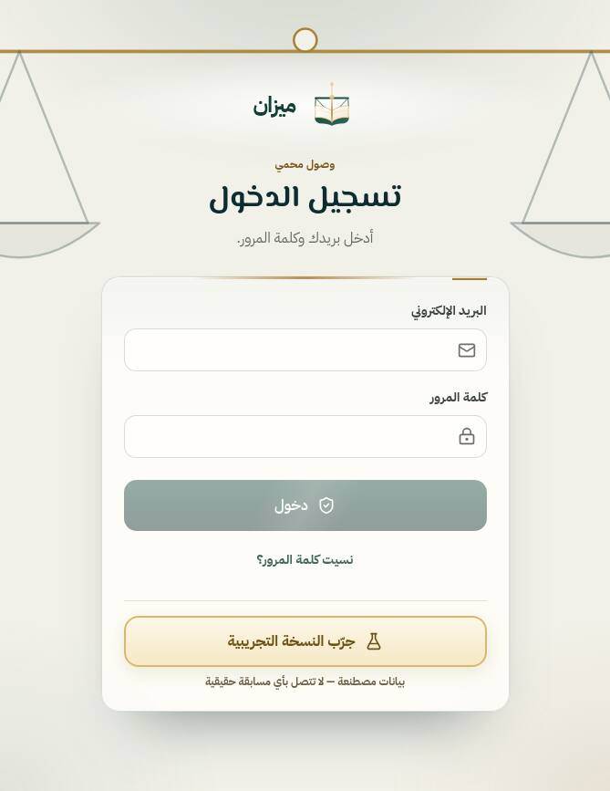 | 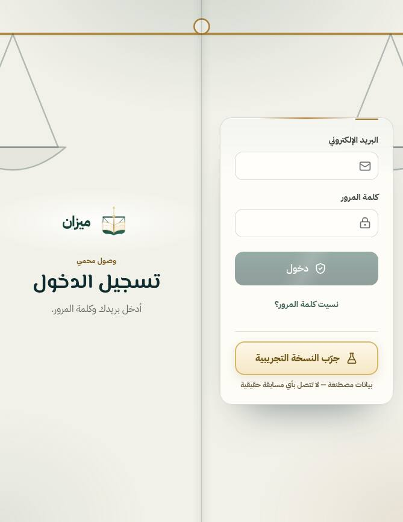 |
| الدخول 951×585 | 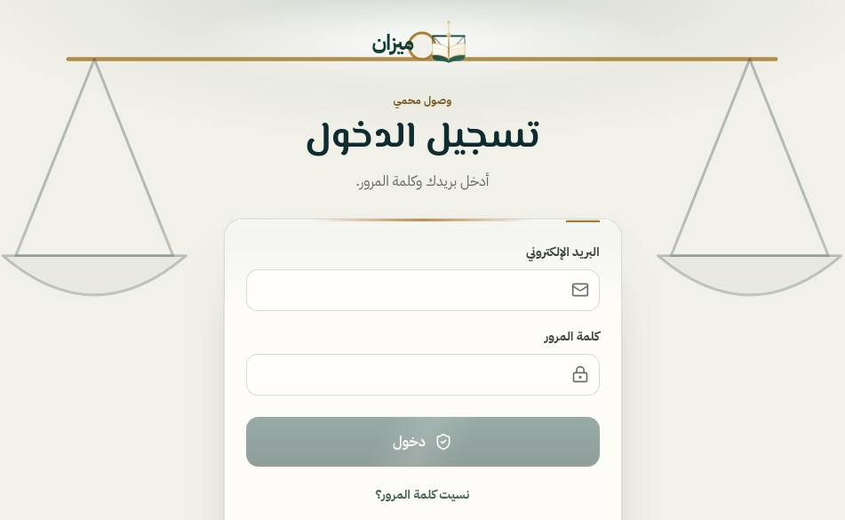 | 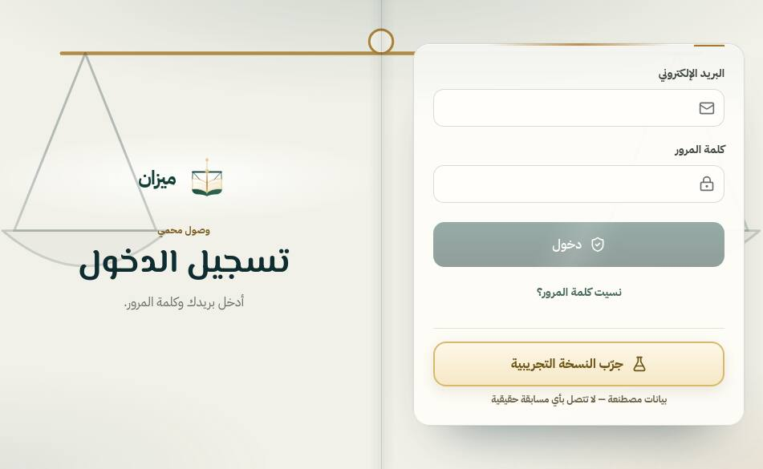 |
| انتظار المحكّم 669×867 | 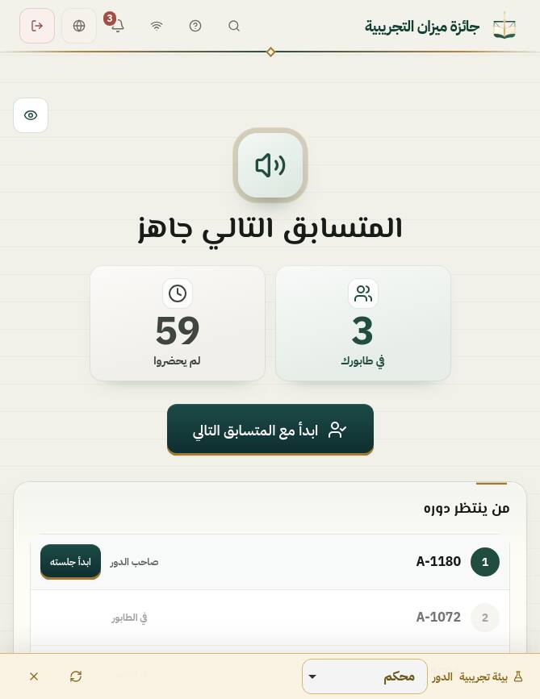 | 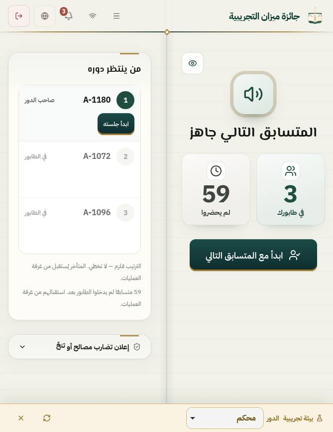 |
| انتظار المحكّم 951×585 | 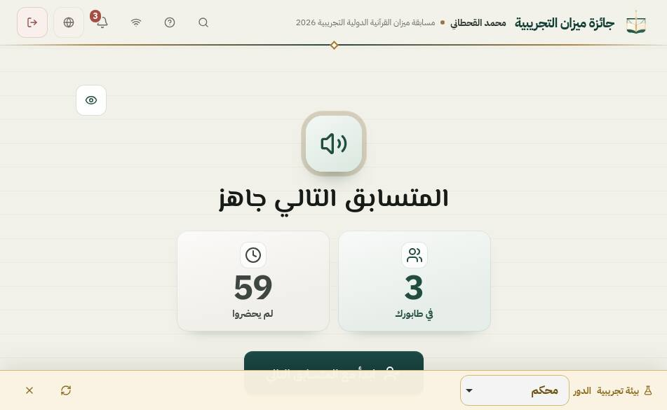 | 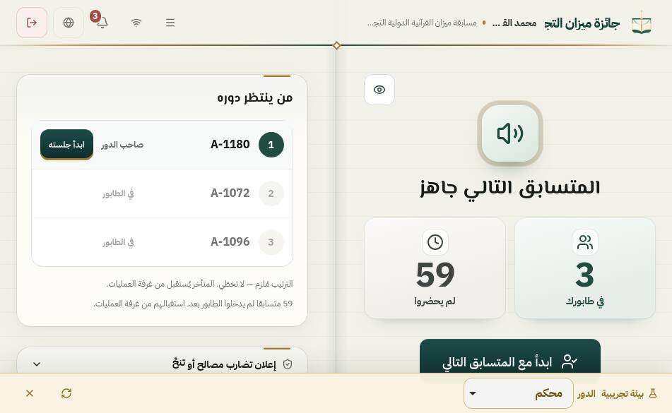 |
| مدير المسابقة 669×867 | 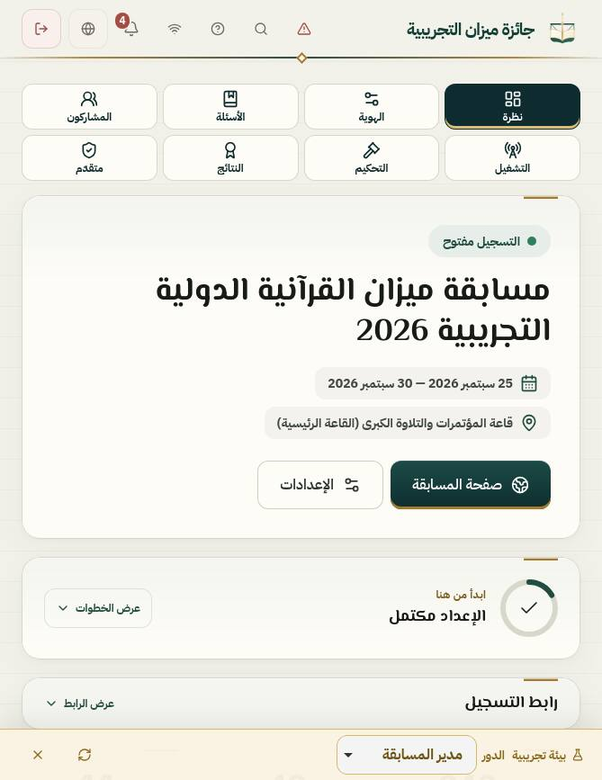 | 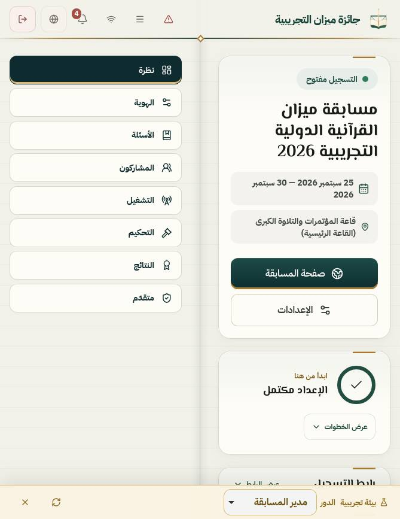 |
| مدير المسابقة 951×585 | 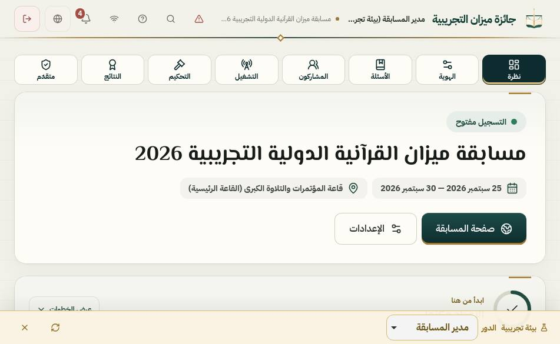 | 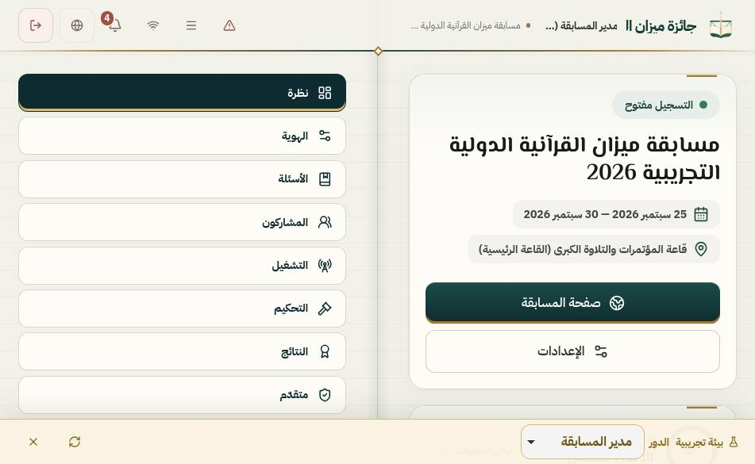 |

بعد فقط: [المتسابق 669×867](iphone-duo-final/after-participant-669x867.jpg)، [قمرة المحكّم 951×585](iphone-duo-final/after-judge-cockpit-951x585.jpg)، [حاسوب محمول: المتسابق 951×350](iphone-duo-final/after-E-laptop-participant-951x350.jpg)، [حاسوب محمول: رئيس التحكيم 600×350](iphone-duo-final/after-E-laptop-head-judge-600x350.jpg)، [مطويّ عرضي: المشاركون 594×368](iphone-duo-final/after-B-outer-landscape-participants-594x368.jpg)، [مطويّ: انتظار المحكّم 382×580](iphone-duo-final/after-A-outer-judge-wait-382x580.jpg).

## 10. الفحوص

| الفحص | الأساس | بعد |
|---|---|---|
| `npm run lint` (`tsc --noEmit`) | PASS | PASS |
| `npm test` | (CI أخضر على main) | 2884 نجح، 0 فشل (منها 5 جديدة في `duo-book-spread.test.ts`). `quran-tayseer-resegmentation` المذكور سابقًا نجح هذه المرة |
| `npm run build` | PASS | PASS |
| `secret-scan`، `source-audit`، `production-audit`، `arabic-ui-audit` | — | PASS (14/14 للعربية) |
| `qa-gate-wait-conditions` | — | PASS: سكربت الفحص لا ينتظر «هدوء الشبكة» |

## 11. قائمة المالك على الجهاز الحقيقي

1. افتح الجهاز كتابًا (طوليًّا ثم عرضيًّا) في Safari: الدخول، وانتظار المحكّم، ومدير المسابقة، والمتسابق. لا شيء على خطّ الطيّ، والصفحتان متوازنتان.
2. قمرة المحكّم مع مسابقة تُلزم بالتسجيل: ابدأ التسجيل، ثم اطوِ وافتح وانتقل إلى Split وعُد. يجب أن يستمرّ التسجيل وأن يُحفظ الملف كاملًا.
3. وضع الحاسوب المحمول (النصف السفلي مسنود): شريط الأقسام/التبويبات أسفل الشاشة تحت الإبهام، ولا يغطي آخر سطر بعد التمرير.
4. إن فُعّل علم Viewport Segments: هل يقع الكعب المرسوم على المفصل تمامًا؟
5. حجم النص الكبير في إعدادات iOS على الصفحتين.
6. حواف الأمان الفعلية حول الكاميرا في الشاشتين.
