# ميزان على iPhone Duo — القبول النهائي: صفحتا الكتاب ومصفوفة الوضعيات الكاملة (14 نوفمبر 2026، مع الجزء الثاني)

هذه الجولة تبني على [IPHONE-DUO-ADAPTIVE-QUALITY.md](IPHONE-DUO-ADAPTIVE-QUALITY.md) (#419) ولا تعيد ما حُلّ فيها. نطاقها طبقة العرض فقط: CSS في كتلة iPhone Duo من [src/index.css](../src/index.css)، ومكوّنٌ عرضيّ واحد [Spread.tsx](../src/components/layout/Spread.tsx)، وأسماء أصنافٍ وسمة `data-duo="aside"` على جذور الصفحات. **لم يُمسّ** التحكيم ولا الدرجات ولا مصادر القرآن ولا القرعة ولا تسجيل الصوت ولا المصادقة ولا Firestore ولا الخادم ولا ملفات النشر ولا CI.

رموز الحالة: `PASS` مُقاس بلا خلل · `PARTIAL` يعمل وفيه ملاحظة مسمّاة · `FAIL` خلل باقٍ · `BLOCKED` يحتاج جهازًا أو بيانات غير متاحة · `NOT_TESTED` لم يُختبر. **لا شيء هنا اختُبر على جهاز iPhone Duo حقيقي.**

## 1. المشكلة والتصميم

على الشاشة الداخلية كانت كل صفحة صفحةَ هاتفٍ ممدودة: العنوان والبطاقات والأزرار تمرّ فوق خطّ الطيّ. القياس على `main` قبل #422 (`2c4698a`، الأساس): **81 من 81** خليةً داخلية فيها عنصرٌ يقع على منطقة الكعب، بمجموع **901** عنصرٍ (نص أو زرّ أو حقل).

الحلّ: **صفحتان لا صفحةٌ ممدودة**.

- **متى**: من مساحة النافذة لا من نوع الجهاز، لأن Safari لا يكشف المفصل: عرض 640–720 طوليًّا بارتفاع ≥ 520 (كتاب طولي 669×867 ونصفه 669×520)، أو عرض 640–1000 عرضيًّا بارتفاع 520–720 (كتاب عرضي 951×585). الآيباد (768×1024، 1024×768) والهاتف والحاسوب خارج الشرط فلا يتغيّر فيها بكسل.
- **الكعب**: 28–36px في المنتصف (`--duo-spine`)، خطٌّ شعريّ وظلُّ طيٍّ خفيف، والخلفية متّصلة حافةً لحافة. يُرسم فقط حين تكون على الشاشة صفحةٌ بورقتين.
- **الورقتان**: ورقة العمل يمنى (بداية القراءة بالعربية)، وورقة السياق يسرى. كل ورقة تنتهي قبل الكعب بهامش `--duo-gutter`، فلا نصّ ولا زرّ ولا حقل ولا عمود جدول على الطيّ.
- **بلا JavaScript للتخطيط**: `Spread` يوزّع الأبناء على ورقتين بحسب `data-duo="aside"` مرّةً واحدة، والتخطيط بعدها CSS خالص. خارج مقاس الكتاب تبقى الورقتان كتلتين متتاليتين بالتباعد نفسه وبترتيب المصدر. **تغيير المقاس لا يعيد تركيب أي مكوّن**، فالتسجيل والتشغيل والحقول والنوافذ تبقى (القسم 6).

| الشاشة | ورقة العمل (يمنى) | ورقة السياق (يسرى) |
|---|---|---|
| الدخول، استعادة كلمة المرور | بطاقة الدخول | العلامة والعنوان تحت محور الميزان |
| انتظار المحكّم | «المتسابق التالي جاهز» وزرّ البدء (مثبّت) | الطابور وتفاصيل الكشف |
| قمرة المحكّم | الورقة (المصحف) | لوحة المفاتيح؛ الكعب بينهما بلون القمرة |
| المتسابق | حالة اليوم (دورك/استعدادك/سجلّك) | الهوية وخطوات الرحلة والتبويبات |
| مدير المسابقة (8 أقسام) | القسم المفتوح | فهرس الأقسام عمودًا واحدًا كفهرس كتاب، مثبّت |
| رئيس التحكيم | المراجعة/الاعتراض المفتوح | العنوان والتبويبات وبلاغ الاستمرارية |
| مركز العمليات | لوحة الحالات وأقسام التدفق | بطاقة «حالات تحتاجك» |
| البوابات (الجهة، الوفد، التدقيق، الاستثناءات، وليّ الأمر، الدعم، غرفة القيادة، المشغّل) | المحتوى | العنوان (صفحة افتتاح بخط ذهبي) والأرقام والتبويبات |
| النوافذ (Modal، الإشعارات، البحث السريع) | النافذة بعرض الصفحة اليمنى | الستار يغطي الاثنتين |
| «اشرح لي هذه الواجهة» | — | الدليل ورقةٌ فوق الصفحة اليسرى |
| شاشة البثّ (الحفل) | المشهد | الترويسة والتذييل نصفان |
| الدليل العام، الجواز، الواجهة التسويقية | القوائم والبطاقات | العنوان والبحث؛ أقسام التسويق عمودان بينهما الكعب |

- **الورقة الضيّقة** (~290px في الكتاب الطولي): المكوّنات تبدّل تخطيطها بعرض الشاشة (`sm:` من 640px) فترى 669 «واسعة» وهي في ورقةٍ بعرض هاتف. استعلام حاوية (`@container mz-leaf`) يعيد داخل الورقة وحدها صفوف «عمودي على الهاتف» وأعمدة الشبكات وحشوها، ويلفّ صفوف الأزرار بدل أن تخرج.
- **وضع الحاسوب المحمول** (951×350، 600×350، 594×368، وآيفون عرضي 844×390): المحتوى فوق والأدوات تحت اليد. شريط أقسام المسابقة الثمانية، وتبويبات ورقة السياق (المتسابق، رئيس التحكيم، غرفة القيادة) تصير شريطًا سفليًّا ثابتًا بارتفاع ~52px، ويُحجز مكانه أسفل الصفحة فلا يغطي سطرًا، ويقف فوق شريط بيئة العرض حين يكون مثبّتًا. الترويسة تنسحب بالتمرير كما في #419.
- **المطويّ** (382×580، 385×571، 320×568): مهمة واحدة واضحة والخلفية ممتدة؛ لم يتغيّر فيه شيء عن #419 سوى إصلاحات أهداف اللمس (القسم 8).
- **المفصل الحقيقي** (اختياري ومعزول): مع `horizontal-viewport-segments:2` يأخذ الكعب عرض المفصل `env(viewport-segment-*)`، وقواعد القمرة المقاسة بالمفصل من #419 تأتي بعد كتلة الكتاب فتغلبها. أُزيلت قاعدتا المفصل الخاصتان بالدخول وانتظار المحكّم لأن الصفحتين تغنيان عنهما.
- **الهوية**: الخطوط والألوان والرموز كما في النظام؛ لا زجاج ثقيل ولا حركة متكرّرة ولا احتفال؛ تقليل الحركة محترم (لا حركة جديدة أصلًا).

## 2. جرد الشاشات

الجرد مستخرج من الموجّه والتنقّل، لا عيّنة:

- **الموجّه** ([App.tsx](../src/App.tsx)): الدخول، `#reset-password`، `#competition` و`#register` و`#journey` و`#guardian` (تحتاج مسابقةً منشورة)، `#discover`، `#passport`، `#manage-competition` (مدير الجهة)، الواجهة التسويقية (مضيف `mizan.*`)، وحالة «مسابقة غير موجودة».
- **الأدوار** (`roleView` + شريط البيئة التجريبية): 18 دورًا — مدير المسابقة، رئيس التحكيم، المحكّم، مدير التشغيل، مكتب الاستثناءات، مدير الوفد، المتسابق، وليّ الأمر، البثّ والحفل، المدقّق، الدعم، مدير الجهة، مدير الفرع، مالك المنصة، مالك المشغّل، مدير المشغّل، مدير التخزين، مدير الفوترة.
- **الأقسام والتبويبات**: يكتشفها فحص `subscreens` من الواجهة نفسها (شريط الأقسام، `role="tab"`، `.mizan-tabs`) فيفتح كل قسم ثم كل تبويبٍ داخله، فلا تسقط شاشة تُضاف لاحقًا. النتيجة: **128 حالة** (الجدول ب).
- **النوافذ والقوائم والحالات**: «اشرح لي هذه الواجهة» (درج)، الإشعارات (Modal)، البحث السريع، قائمة «المزيد»، قمرة المحكّم ببواباتها الثلاث (الميكروفون، الحضور، الموافقة) ثم الموضع مفتوحًا (في ذاكرة بيئة العرض فقط)، الحالة الفارغة (مالك المنصة بلا خادم، الدليل العام بلا مسابقات)، الخطأ (مسابقة غير موجودة، رابط استعادة غير صالح).
- **BLOCKED**: `#competition`/`#register`/`#journey`/`#guardian` لمسابقة منشورة (تحتاج مسابقةً في Firestore؛ البيئة التجريبية تجيب عنها محليًّا بالرفض، فلا يُرى إلا «غير موجودة» وهي مقاسة)؛ مسار تدرّب المتسابق بالمصحف (حزم المصحف غير موجودة في العرض عمدًا)؛ نوافذ التأكيد الهدّامة (حذف جهة/مشغّل) لم تُفتح حتى لا يُكتب شيء.

## 3. الوضعيات

| الوضعية | المقاسات المقيسة |
|---|---|
| A مطوي طولي | 382×580، 385×571، 320×568 |
| B مطوي عرضي | 594×368 |
| C كتاب طولي (الداخلية) | 669×867 |
| D كتاب عرضي (الداخلية) | 951×585 |
| E حاسوب محمول | 951×350، 600×350 |
| F نصف/قصير | 669×520 (داخلية)، 600×480 |
| G لوح/حاسوب | 768×1024، 1024×768، 1280×800، 1440×900 |
| H مراجع الهاتف | 360×640، 390×844، 844×390 (+ Split: 320/470/620 × 350/600/900 في الجدول أ) |
| I تسلسل حيّ | 951×585 → 669×867 → 470×700 → 382×580 → 594×368 → 951×350 → 951×585 على صفحةٍ واحدة بلا إعادة تحميل |
| J ضغط الإتاحة | نص 200%، داكن، تقليل الحركة، لوحة المفاتيح، حواف أمان غير متماثلة |

## 4. المنهج والأداة

Playwright **WebKit** (محرّك Safari، playwright 1.63) على خادم التطوير بالبيئة التجريبية المعزولة (لا كتابة في أي خادم). السكربت: [scripts/duo-final-audit.mjs](../scripts/duo-final-audit.mjs).

```
PORT=5130 DISABLE_HMR=true npx tsx server.ts &
PLAYWRIGHT_BROWSERS_PATH=/opt/pw-browsers node scripts/duo-final-audit.mjs --base=http://127.0.0.1:5130 \
  --out=docs/iphone-duo-final/audit-report.json [--only=matrix,live,stress,subscreens] [--roles=comp_admin,...] \
  [--shots=<مجلد> --shot-sizes=669x867,951x585,951x350,600x350,594x368,382x580]
```

ما يُقاس في كل خلية: التمرير الأفقي (`scrollWidth − clientWidth`)، العناصر المهمة الخارجة عن الشاشة أو المقصوصة (بعد قصّ كل أبٍ يقصّ؛ ما داخل حاويةٍ مُمرَّرة عمدًا مستثنى)، أهداف اللمس دون 44px، وفي المقاس الداخلي: **كل نصّ (بمستطيلات أسطره) أو عنصر تفاعلي يقع على منطقة الكعب** (المنتصف ± نصف عرض الكعب المرسوم)، وكل عنصر يخرج من ورقته. أخطاء الصفحة المسجّلة كلها `Firestore/Listen` (لا شبكة إلى Google في بيئة الفحص) لا أخطاء عرض.

التقرير الكامل: [iphone-duo-final/audit-report.json](iphone-duo-final/audit-report.json).

## 5. النتيجة بالأرقام

| المقياس | الأساس (`main` قبل #422) | بعد |
|---|---|---|
| خلايا داخلية فيها عنصر على الكعب | 81 / 81 (901 عنصرًا) | 0 / 87؛ والشاشات الفرعية: 0 / 384 |
| تمرير أفقي غير مقصود | 2 خلية | 0 (والشاشات الفرعية: 0) |
| عناصر خارج الشاشة | 0 | 0 (والشاشات الفرعية: 0) |
| أهداف لمس دون 44px | 52 خلية | 22 (كلها زرّ «إيقاف مؤقت» السابق في الواجهة التسويقية؛ والشاشات الفرعية: 0) |

مجموع ما قيس بعد التعديل: **2546 خلية** (29 شاشة/حالة × 29 مقاسًا، و128 شاشة فرعية × 14 مقاسًا، دون الحيّ والضغط).

## 5ب. المصفوفة: كل شاشة × الوضعيات A–H

الحالة لكل وضعية هي أسوأ مقاساتها. I وJ في القسمين 6 و7. كل الأرقام من تشغيلٍ كامل على الجزء الثاني (بعد الدمج الأول).

### أ) الشاشات الرئيسة والحالات (مصفوفة كاملة: 29 مقاسًا لكل شاشة)

| الشاشة | A | B | C | D | E | F | G | H | ملاحظات |
|---|---|---|---|---|---|---|---|---|---|
| `login` الدخول | PASS | PASS | PASS | PASS | PASS | PASS | PASS | PASS |  |
| `reset` استعادة كلمة المرور | PASS | PASS | PASS | PASS | PASS | PASS | PASS | PASS |  |
| `notfound` خطأ: مسابقة غير موجودة | PASS | PASS | PASS | PASS | PASS | PASS | PASS | PASS |  |
| `discover` دليل المسابقات العام (#discover) | PASS | PASS | PASS | PASS | PASS | PASS | PASS | PASS |  |
| `passport` جواز ميزان العام (#passport) | PASS | PASS | PASS | PASS | PASS | PASS | PASS | PASS |  |
| `marketing` الواجهة التسويقية (mizan.*) | PASS | PASS | PARTIAL | PARTIAL | PARTIAL | PARTIAL | PARTIAL | PARTIAL | 669x867 هدف لمس <44 1؛ 951x585 هدف لمس <44 1؛ 600x350 هدف لمس <44 1؛ 951x350 هدف لمس <44 1؛ 600x480 هدف لمس <44 1؛ 669x520 هدف لمس <44 1؛ 1024x768 هدف لمس <44 1؛ 1280x800 هدف لمس <44 1؛ 1440x900 هدف لمس <44 1؛ 360x640 هد |
| `judge-wait` المحكّم: الانتظار | PASS | PASS | PASS | PASS | PASS | PASS | PASS | PASS |  |
| `judge-cockpit` المحكّم: القمرة | PASS | PASS | PASS | PASS | PASS | PASS | PASS | PASS |  |
| `judge-cockpit-approval` المحكّم: القمرة — بوابة الموافقة | PASS | PASS | PASS | PASS | PASS | PASS | PASS | PASS |  |
| `judge-cockpit-open` المحكّم: القمرة — الموضع مفتوح (بيئة العرض، في الذاكرة) | PASS | PASS | PASS | PASS | PASS | PASS | PASS | PASS |  |
| `participant` المتسابق | PASS | PASS | PASS | PASS | PASS | PASS | PASS | PASS |  |
| `comp-overview` مدير المسابقة: نظرة | PASS | PASS | PASS | PASS | PASS | PASS | PASS | PASS |  |
| `comp-participants` مدير المسابقة: المشاركون | PASS | PASS | PASS | PASS | PASS | PASS | PASS | PASS |  |
| `comp-results` مدير المسابقة: النتائج | PASS | PASS | PASS | PASS | PASS | PASS | PASS | PASS |  |
| `head-judge` رئيس التحكيم | PASS | PASS | PASS | PASS | PASS | PASS | PASS | PASS |  |
| `ops` مركز العمليات | PASS | PASS | PASS | PASS | PASS | PASS | PASS | PASS |  |
| `org` مدير الجهة | PASS | PASS | PASS | PASS | PASS | PASS | PASS | PASS |  |
| `auditor` المدقّق | PASS | PASS | PASS | PASS | PASS | PASS | PASS | PASS |  |
| `delegation` مدير الوفد | PASS | PASS | PASS | PASS | PASS | PASS | PASS | PASS |  |
| `guardian` وليّ الأمر | PASS | PASS | PASS | PASS | PASS | PASS | PASS | PASS |  |
| `exception` مكتب الاستثناءات | PASS | PASS | PASS | PASS | PASS | PASS | PASS | PASS |  |
| `support` الدعم | PASS | PASS | PASS | PASS | PASS | PASS | PASS | PASS |  |
| `super-admin` مالك المنصة (فارغ بلا خادم) | PASS | PASS | PASS | PASS | PASS | PASS | PASS | PASS |  |
| `operator` المشغّل | PASS | PASS | PASS | PASS | PASS | PASS | PASS | PASS |  |
| `broadcast` شاشة البثّ | PASS | PASS | PASS | PASS | PASS | PASS | PASS | PASS |  |
| `sheet-notifications` لوحة: الإشعارات | PASS | PASS | PASS | PASS | PASS | PASS | PASS | PASS |  |
| `dialog-search` نافذة: البحث السريع | PASS | PASS | PASS | PASS | PASS | PASS | PASS | PASS |  |
| `menu-more` قائمة: المزيد | PASS | PASS | PASS | PASS | PASS | PASS | PASS | PASS |  |
| `dialog-help` نافذة: اشرح لي هذه الواجهة | PASS | PASS | PASS | PASS | PASS | PASS | PASS | PASS |  |

### ب) جرد الشاشات الفرعية — كل قسمٍ وتبويبٍ وتبويبٍ داخلي (128 حالة × 14 مقاسًا)

| الشاشة | A | B | C | D | E | F | G | H | ملاحظات |
|---|---|---|---|---|---|---|---|---|---|
| `comp_admin` | PASS | PASS | PASS | PASS | PASS | PASS | PASS | PASS |  |
| `comp_admin/نظرة` | PASS | PASS | PASS | PASS | PASS | PASS | PASS | PASS |  |
| `comp_admin/الهوية` | PASS | PASS | PASS | PASS | PASS | PASS | PASS | PASS |  |
| `comp_admin/الهوية/بيانات المسابقة` | PASS | PASS | PASS | PASS | PASS | PASS | PASS | PASS |  |
| `comp_admin/الهوية/الفئات (4)` | PASS | PASS | PASS | PASS | PASS | PASS | PASS | PASS |  |
| `comp_admin/الهوية/رابط التسجيل` | PASS | PASS | PASS | PASS | PASS | PASS | PASS | PASS |  |
| `comp_admin/الأسئلة` | PASS | PASS | PASS | PASS | PASS | PASS | PASS | PASS |  |
| `comp_admin/الأسئلة/النطاق` | PASS | PASS | PASS | PASS | PASS | PASS | PASS | PASS |  |
| `comp_admin/الأسئلة/الأجزاء` | PASS | PASS | PASS | PASS | PASS | PASS | PASS | PASS |  |
| `comp_admin/الأسئلة/توزيع الأسئلة` | PASS | PASS | PASS | PASS | PASS | PASS | PASS | PASS |  |
| `comp_admin/الأسئلة/سياسة الأسئلة` | PASS | PASS | PASS | PASS | PASS | PASS | PASS | PASS |  |
| `comp_admin/الأسئلة/المحاكاة` | PASS | PASS | PASS | PASS | PASS | PASS | PASS | PASS |  |
| `comp_admin/الأسئلة/الجاهزية` | PASS | PASS | PASS | PASS | PASS | PASS | PASS | PASS |  |
| `comp_admin/المشاركون` | PASS | PASS | PASS | PASS | PASS | PASS | PASS | PASS |  |
| `comp_admin/التشغيل` | PASS | PASS | PASS | PASS | PASS | PASS | PASS | PASS |  |
| `comp_admin/التحكيم` | PASS | PASS | PASS | PASS | PASS | PASS | PASS | PASS |  |
| `comp_admin/التحكيم/اللجان` | PASS | PASS | PASS | PASS | PASS | PASS | PASS | PASS |  |
| `comp_admin/التحكيم/الفريق والصلاحيات` | PASS | PASS | PASS | PASS | PASS | PASS | PASS | PASS |  |
| `comp_admin/النتائج` | PASS | PASS | PASS | PASS | PASS | PASS | PASS | PASS |  |
| `comp_admin/متقدّم` | PASS | PASS | PASS | PASS | PASS | PASS | PASS | PASS |  |
| `comp_admin/متقدّم/القنوات` | PASS | PASS | PASS | PASS | PASS | PASS | PASS | PASS |  |
| `comp_admin/متقدّم/البنية الميدانية` | PASS | PASS | PASS | PASS | PASS | PASS | PASS | PASS |  |
| `comp_admin/متقدّم/الجهات` | PASS | PASS | PASS | PASS | PASS | PASS | PASS | PASS |  |
| `comp_admin/متقدّم/الجاهزية` | PASS | PASS | PASS | PASS | PASS | PASS | PASS | PASS |  |
| `comp_admin/متقدّم/أدوات الإدارة` | PASS | PASS | PASS | PASS | PASS | PASS | PASS | PASS |  |
| `head_judge` | PASS | PASS | PASS | PASS | PASS | PASS | PASS | PASS |  |
| `head_judge/مراجعات التحكيم` | PASS | PASS | PASS | PASS | PASS | PASS | PASS | PASS |  |
| `head_judge/الاعتراضات` | PASS | PASS | PASS | PASS | PASS | PASS | PASS | PASS |  |
| `head_judge/حالة اللجنة` | PASS | PASS | PASS | PASS | PASS | PASS | PASS | PASS |  |
| `head_judge/الختم والطوارئ` | PASS | PASS | PASS | PASS | PASS | PASS | PASS | PASS |  |
| `head_judge/تضارب المصالح` | PASS | PASS | PASS | PASS | PASS | PASS | PASS | PASS |  |
| `judge` | PASS | PASS | PASS | PASS | PASS | PASS | PASS | PASS |  |
| `ops_manager` | PASS | PASS | PASS | PASS | PASS | PASS | PASS | PASS |  |
| `ops_manager/النبض والمقاييس` | PASS | PASS | PASS | PASS | PASS | PASS | PASS | PASS |  |
| `ops_manager/التلاوة الجارية` | PASS | PASS | PASS | PASS | PASS | PASS | PASS | PASS |  |
| `ops_manager/اللجان والصحة` | PASS | PASS | PASS | PASS | PASS | PASS | PASS | PASS |  |
| `ops_manager/الرؤى والطابور` | PASS | PASS | PASS | PASS | PASS | PASS | PASS | PASS |  |
| `exception_host` | PASS | PASS | PASS | PASS | PASS | PASS | PASS | PASS |  |
| `delegation_manager` | PASS | PASS | PASS | PASS | PASS | PASS | PASS | PASS |  |
| `participant` | PASS | PASS | PASS | PASS | PASS | PASS | PASS | PASS |  |
| `participant/دورك` | PASS | PASS | PASS | PASS | PASS | PASS | PASS | PASS |  |
| `participant/استعدادك` | PASS | PASS | PASS | PASS | PASS | PASS | PASS | PASS |  |
| `participant/سجلّك` | PASS | PASS | PASS | PASS | PASS | PASS | PASS | PASS |  |
| `guardian` | PASS | PASS | PASS | PASS | PASS | PASS | PASS | PASS |  |
| `broadcast_operator` | PASS | PASS | PASS | PASS | PASS | PASS | PASS | PASS |  |
| `auditor` | PASS | PASS | PASS | PASS | PASS | PASS | PASS | PASS |  |
| `support_agent` | PASS | PASS | PASS | PASS | PASS | PASS | PASS | PASS |  |
| `org_admin` | PASS | PASS | PASS | PASS | PASS | PASS | PASS | PASS |  |
| `org_admin/المسابقات` | PASS | PASS | PASS | PASS | PASS | PASS | PASS | PASS |  |
| `org_admin/إدارة الجهة` | PASS | PASS | PARTIAL | PASS | PASS | PARTIAL | PASS | PASS | 669x867 خارج الورقة 1؛ 669x520 خارج الورقة 1 |
| `org_admin/إدارة الجهة/الشعار والوضوح` | PASS | PASS | PARTIAL | PASS | PASS | PARTIAL | PASS | PASS | 669x867 خارج الورقة 1؛ 669x520 خارج الورقة 1 |
| `org_admin/إدارة الجهة/البيانات المؤسسية` | PASS | PASS | PASS | PASS | PASS | PASS | PASS | PASS |  |
| `org_admin/إدارة الجهة/مواضع العرض` | PASS | PASS | PASS | PASS | PASS | PASS | PASS | PASS |  |
| `org_admin/إدارة الجهة/النطاق` | PASS | PASS | PASS | PASS | PASS | PASS | PASS | PASS |  |
| `org_admin/الاستخدام والترخيص` | PASS | PASS | PASS | PASS | PASS | PASS | PASS | PASS |  |
| `org_admin/الاستخدام والترخيص/الاشتراك ودورته` | PASS | PASS | PASS | PASS | PASS | PASS | PASS | PASS |  |
| `org_admin/الاستخدام والترخيص/الاستخدام والخطة` | PASS | PASS | PASS | PASS | PASS | PASS | PASS | PASS |  |
| `org_admin/الاستخدام والترخيص/هوية الترخيص` | PASS | PASS | PASS | PASS | PASS | PASS | PASS | PASS |  |
| `org_admin/الاستخدام والترخيص/التخزين` | PASS | PASS | PASS | PASS | PASS | PASS | PASS | PASS |  |
| `org_admin/الاستخدام والترخيص/العلامة التجارية` | PASS | PASS | PASS | PASS | PASS | PASS | PASS | PASS |  |
| `org_admin/الاستخدام والترخيص/الدخول الموحّد` | PASS | PASS | PASS | PASS | PASS | PASS | PASS | PASS |  |
| `org_admin/الاستخدام والترخيص/بوابة الدفع` | PASS | PASS | PASS | PASS | PASS | PASS | PASS | PASS |  |
| `branch_admin` | PASS | PASS | PASS | PASS | PASS | PASS | PASS | PASS |  |
| `super_admin` | PASS | PASS | PASS | PASS | PASS | PASS | PASS | PASS |  |
| `super_admin/الصحة والتنبيهات` | PASS | PASS | PASS | PASS | PASS | PASS | PASS | PASS |  |
| `super_admin/التجارة والاشتراكات` | PASS | PASS | PASS | PASS | PASS | PASS | PASS | PASS |  |
| `super_admin/التجارة والاشتراكات/نظرة عامة` | PASS | PASS | PASS | PASS | PASS | PASS | PASS | PASS |  |
| `super_admin/التجارة والاشتراكات/الجهات` | PASS | PASS | PASS | PASS | PASS | PASS | PASS | PASS |  |
| `super_admin/التجارة والاشتراكات/المشغّلون` | PASS | PASS | PASS | PASS | PASS | PASS | PASS | PASS |  |
| `super_admin/التجارة والاشتراكات/الخطط والأسعار` | PASS | PASS | PASS | PASS | PASS | PASS | PASS | PASS |  |
| `super_admin/التجارة والاشتراكات/الكتالوج والمشغّلون والرصيد` | PASS | PASS | PASS | PASS | PASS | PASS | PASS | PASS |  |
| `super_admin/التجارة والاشتراكات/الفوترة والاشتراكات` | PASS | PASS | PASS | PASS | PASS | PASS | PASS | PASS |  |
| `super_admin/التجارة والاشتراكات/طلبات التعديل` | PASS | PASS | PASS | PASS | PASS | PASS | PASS | PASS |  |
| `super_admin/التجارة والاشتراكات/سجل النشاط` | PASS | PASS | PASS | PASS | PASS | PASS | PASS | PASS |  |
| `super_admin/الحوكمة والأمان` | PASS | PASS | PASS | PASS | PASS | PASS | PASS | PASS |  |
| `super_admin/الحوكمة والأمان/الهوية والمطالبات` | PASS | PASS | PASS | PASS | PASS | PASS | PASS | PASS |  |
| `super_admin/الحوكمة والأمان/النطاق والحدود` | PASS | PASS | PASS | PASS | PASS | PASS | PASS | PASS |  |
| `super_admin/الحوكمة والأمان/الوحدات والحوكمة` | PASS | PASS | PASS | PASS | PASS | PASS | PASS | PASS |  |
| `super_admin/المكتبة الرسمية` | PASS | PASS | PASS | PASS | PASS | PASS | PASS | PASS |  |
| `operator_owner` | PASS | PASS | PASS | PASS | PASS | PASS | PASS | PASS |  |
| `operator_owner/الرصيد والعملاء` | PASS | PASS | PASS | PASS | PASS | PASS | PASS | PASS |  |
| `operator_owner/الجهات` | PASS | PASS | PASS | PASS | PASS | PASS | PASS | PASS |  |
| `operator_owner/الجهات/الفريق والصلاحيات` | PASS | PASS | PASS | PASS | PASS | PASS | PASS | PASS |  |
| `operator_owner/الجهات/طلبات كلمة المرور` | PASS | PASS | PASS | PASS | PASS | PASS | PASS | PASS |  |
| `operator_owner/الجهات/الجلسات` | PASS | PASS | PASS | PASS | PASS | PASS | PASS | PASS |  |
| `operator_owner/الجهات/إضافة مستخدم+` | PASS | PASS | PASS | PASS | PASS | PASS | PASS | PASS |  |
| `operator_owner/باقاتي` | PASS | PASS | PASS | PASS | PASS | PASS | PASS | PASS |  |
| `operator_owner/الفوترة` | PASS | PASS | PASS | PASS | PASS | PASS | PASS | PASS |  |
| `operator_owner/الفوترة/الكل` | PASS | PASS | PASS | PASS | PASS | PASS | PASS | PASS |  |
| `operator_owner/الفوترة/لم تُدفع` | PASS | PASS | PASS | PASS | PASS | PASS | PASS | PASS |  |
| `operator_owner/الفوترة/متأخرة` | PASS | PASS | PASS | PASS | PASS | PASS | PASS | PASS |  |
| `operator_owner/الفوترة/مدفوعة` | PASS | PASS | PASS | PASS | PASS | PASS | PASS | PASS |  |
| `operator_owner/العملاء` | PASS | PASS | PASS | PASS | PASS | PASS | PASS | PASS |  |
| `operator_owner/حركات الرصيد` | PASS | PASS | PASS | PASS | PASS | PASS | PASS | PASS |  |
| `operator_owner/سعر الجملة` | PASS | PASS | PASS | PASS | PASS | PASS | PASS | PASS |  |
| `operator_owner/العلامة التجارية` | PASS | PASS | PASS | PASS | PASS | PASS | PASS | PASS |  |
| `operator_owner/بوابة الدفع` | PASS | PASS | PASS | PASS | PASS | PASS | PASS | PASS |  |
| `operator_admin` | PASS | PASS | PASS | PASS | PASS | PASS | PASS | PASS |  |
| `operator_admin/الرصيد والعملاء` | PASS | PASS | PASS | PASS | PASS | PASS | PASS | PASS |  |
| `operator_admin/الجهات` | PASS | PASS | PASS | PASS | PASS | PASS | PASS | PASS |  |
| `operator_admin/الجهات/الفريق والصلاحيات` | PASS | PASS | PASS | PASS | PASS | PASS | PASS | PASS |  |
| `operator_admin/الجهات/طلبات كلمة المرور` | PASS | PASS | PASS | PASS | PASS | PASS | PASS | PASS |  |
| `operator_admin/الجهات/الجلسات` | PASS | PASS | PASS | PASS | PASS | PASS | PASS | PASS |  |
| `operator_admin/باقاتي` | PASS | PASS | PASS | PASS | PASS | PASS | PASS | PASS |  |
| `operator_admin/الفوترة` | PASS | PASS | PASS | PASS | PASS | PASS | PASS | PASS |  |
| `operator_admin/الفوترة/الكل` | PASS | PASS | PASS | PASS | PASS | PASS | PASS | PASS |  |
| `operator_admin/الفوترة/لم تُدفع` | PASS | PASS | PASS | PASS | PASS | PASS | PASS | PASS |  |
| `operator_admin/الفوترة/متأخرة` | PASS | PASS | PASS | PASS | PASS | PASS | PASS | PASS |  |
| `operator_admin/الفوترة/مدفوعة` | PASS | PASS | PASS | PASS | PASS | PASS | PASS | PASS |  |
| `operator_admin/العملاء` | PASS | PASS | PASS | PASS | PASS | PASS | PASS | PASS |  |
| `operator_admin/حركات الرصيد` | PASS | PASS | PASS | PASS | PASS | PASS | PASS | PASS |  |
| `operator_admin/سعر الجملة` | PASS | PASS | PASS | PASS | PASS | PASS | PASS | PASS |  |
| `operator_admin/العلامة التجارية` | PASS | PASS | PASS | PASS | PASS | PASS | PASS | PASS |  |
| `operator_admin/بوابة الدفع` | PASS | PASS | PASS | PASS | PASS | PASS | PASS | PASS |  |
| `storage_admin` | PASS | PASS | PASS | PASS | PASS | PASS | PASS | PASS |  |
| `storage_admin/المسابقات` | PASS | PASS | PASS | PASS | PASS | PASS | PASS | PASS |  |
| `storage_admin/الاستخدام والترخيص` | PASS | PASS | PASS | PASS | PASS | PASS | PASS | PASS |  |
| `storage_admin/الاشتراك ودورته` | PASS | PASS | PASS | PASS | PASS | PASS | PASS | PASS |  |
| `storage_admin/الاستخدام والخطة` | PASS | PASS | PASS | PASS | PASS | PASS | PASS | PASS |  |
| `storage_admin/هوية الترخيص` | PASS | PASS | PASS | PASS | PASS | PASS | PASS | PASS |  |
| `storage_admin/التخزين` | PASS | PASS | PASS | PASS | PASS | PASS | PASS | PASS |  |
| `billing_admin` | PASS | PASS | PASS | PASS | PASS | PASS | PASS | PASS |  |
| `billing_admin/المسابقات` | PASS | PASS | PASS | PASS | PASS | PASS | PASS | PASS |  |
| `billing_admin/الاستخدام والترخيص` | PASS | PASS | PASS | PASS | PASS | PASS | PASS | PASS |  |
| `billing_admin/الاشتراك ودورته` | PASS | PASS | PASS | PASS | PASS | PASS | PASS | PASS |  |
| `billing_admin/الاستخدام والخطة` | PASS | PASS | PASS | PASS | PASS | PASS | PASS | PASS |  |
| `billing_admin/هوية الترخيص` | PASS | PASS | PASS | PASS | PASS | PASS | PASS | PASS |  |
| `billing_admin/بوابة الدفع` | PASS | PASS | PASS | PASS | PASS | PASS | PASS | PASS |  |

## 6. الوضعية I — التسلسل الحيّ (بلا إعادة تحميل)

| المسار | ما ثبت | الحالة |
|---|---|---|
| قمرة المحكّم أثناء جلسة | العقدة `.mizan-judge-os` نفسها في الخطوات السبع، وعدّاد الجلسة يجري (00:02 ← 00:11)، والأعمدة: صفحتان متساويتان (458+458، 320+320) ← عمود ← ورقة ولوحة (951×350) ← صفحتان. لا تمرير أفقي | PASS |
| مدير المسابقة «المشاركون» | النص المكتوب في البحث (`A-10`) باقٍ في الخطوات السبع، والقسم المختار باقٍ | PASS |
| موضع التمرير | التسلسل كاملًا (مع بحثٍ مكتوب وتركيزٍ عليه): 240 ← 240 ← 240 ← 240 ← 240 ← 212 ← 212. النصّ باقٍ: نعم | PASS |
| نافذة «اشرح لي» مفتوحة | مفتوحة وداخل الشاشة في الخطوات السبع | PASS |
| تبويب المتسابق المختار («استعدادك») | باقٍ في الخطوات السبع | PASS |
| **تسجيل صوت حقيقي أثناء التبديل** | سياسة مسابقة العرض لا تطلب التسجيل، فالقمرة لا تفتح الميكروفون («متابعة بلا ميكروفون»). المبرّر الهيكلي: لا `matchMedia`/`innerWidth` في `Spread` ولا في مسار القمرة (اختبار [duo-book-spread.test.ts](../tests/duo-book-spread.test.ts))، وهوية العقدة ثابتة | NOT_TESTED (الصوت نفسه) |

## 7. الوضعية J — ضغط الإتاحة

| الحالة | المقاسات | النتيجة | الحالة |
|---|---|---|---|
| داكن (`colorScheme: dark`) | 669×867، 951×585 × 8 شاشات | لا تمرير، ولا عبور، ولا خروج. التطبيق فاتحٌ بالتصميم (لا قواعد `prefers-color-scheme`)، فلا يتغيّر فيه شيء | PASS |
| تقليل الحركة | 669×867، 951×585 × 8 | لا حركة متكرّرة جارية (0 عنصر)، ولا خلل | PASS |
| حواف أمان غير متماثلة (محقونة: 47px أعلى، 34px أسفل، 12px و44px على الجانبين) | 669×867، 951×585، 382×580 × 8 | لا تمرير، ولا عبور، ولا خروج | PASS |
| لوحة المفاتيح (حقلٌ مركَّز، ثم ينخفض الارتفاع إلى 350) | الدخول 669 و951، المشاركون 669 و951 | الحقل مركَّز ومرئي، والقيمة باقية، ولا تمرير | PASS |
| نص 200% (`html{font-size:200%}`) | 669×867، 951×585، 382×580 × 8 شاشات (الدخول، الانتظار، القمرة، المتسابق، النظرة العامة، رئيس التحكيم، العمليات، الجهة) | الدخول نظيف في الكتاب. في 669 كان الأساس يمرّر أفقيًّا 93px في النظرة العامة و75px في الجهة، وصار 0 فيهما. بقي تمرير 72px في العمليات عند 669، وعبورٌ للكعب في كل الشاشات (1–12 عنصرًا) لأن الأزرار والعناوين تتضاعف داخل ورقةٍ عرضها نحو 290px. في 382 تمرير 154–250px، وهو موجود قبل التعديل بالقدر نفسه | PARTIAL |

## 8. ما بقي (P0/P1/P2)

**P0**: لا شيء معروف.

**P1**
- نص 200% في الكتاب: يعبر الكعب ما بين عنصرٍ و12 عنصرًا في كل شاشة. وتمرّر العمليات أفقيًّا 72px عند 669. وفي المطويّ 382 تمريرٌ أفقي موجود قبل التعديل. يحتاج جولة «حجم نص ديناميكي» مستقلة.
- لم يُختبر شيء على iPhone Duo حقيقي، ولا مع Viewport Segments فعلية (WebKit لا يحاكيها؛ لا صنف قسري بُني لها). القسم 4 من كتلة CSS يبقى تحسينًا تدريجيًّا لم يُقَس هنا.

**P2**
- قمرة المحكّم والموضع مفتوح، في Split 320×900 فقط: زرّ «عرض النص» في أدوات المصحف مقصوص جزئيًّا. رُفعت أدوات المصحف في القمرة من 38px إلى 44px لتبلغ أرضية اللمس، وقد يكون هذا سبب القصّ. لم يُقَس على الأساس.
- `org_admin/إدارة الجهة`: زرّ «حفظ إعدادات الهوية ومواضع العرض» يخرج 5px من حافة ورقته الخارجية (لا يقترب من الكعب).
- الواجهة التسويقية: زرّ «إيقاف مؤقت» في محاكي التحكيم ارتفاعه 38px (سابق، كل المقاسات).
- `#competition` و`#register` و`#journey` و`#guardian` لمسابقة منشورة: BLOCKED (تحتاج مسابقةً في Firestore).

إصلاحات صغيرة في المرور (كل المقاسات، عرضٌ فقط): أزرار الروايات `min-h-10` صارت 44px، زرّا «حذف» و«إضافة ربط مجموعة بدور» في الدخول الموحّد 44×44، عنوان «تعديل نطاق هذه المنطقة» 44px، حقلا عدد الأسئلة لا يضيقان دون 44px، زرّ إغلاق النوافذ 44px دائمًا، شبكة الأجزاء الثلاثين لا تضيق مفاتيحها في الورقة، وأزرار بطاقات الجهات/المشغّلين لا تخرج من البطاقة في الهاتف، ولا يتجاوز أي زرّ (`.mizan-btn`) عرض حاويته (زرّ «إضافة المستخدم وإنشاء QR» كان خارج الشاشة في 320×568).

## 9. صور قبل/بعد (في [iphone-duo-final/](iphone-duo-final/))

| الشاشة | قبل | بعد |
|---|---|---|
| الدخول 669×867 | 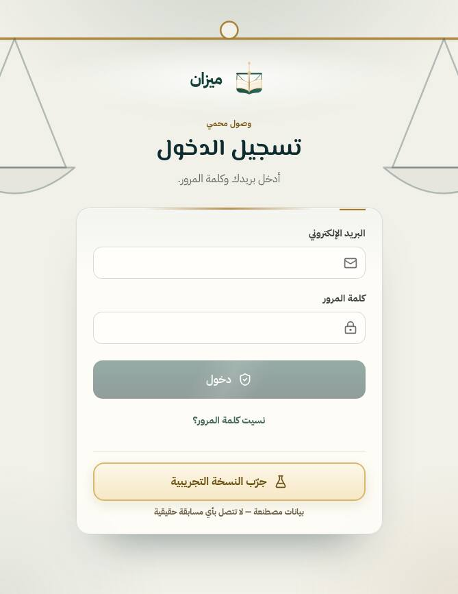 | 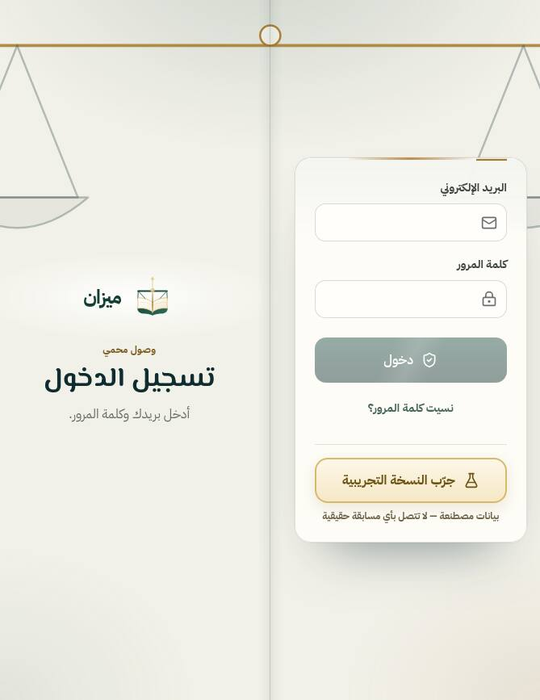 |
| الدخول 951×585 | 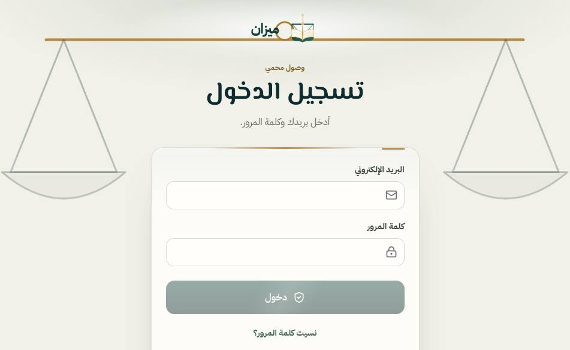 | 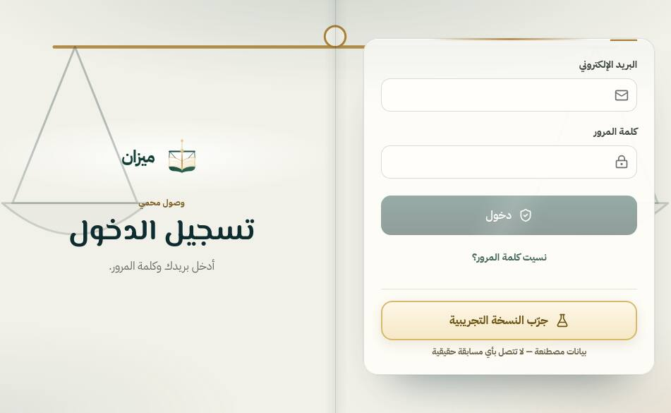 |
| انتظار المحكّم 669×867 | 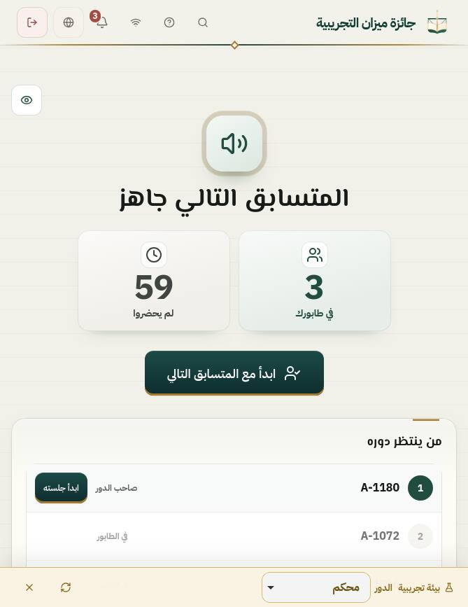 | 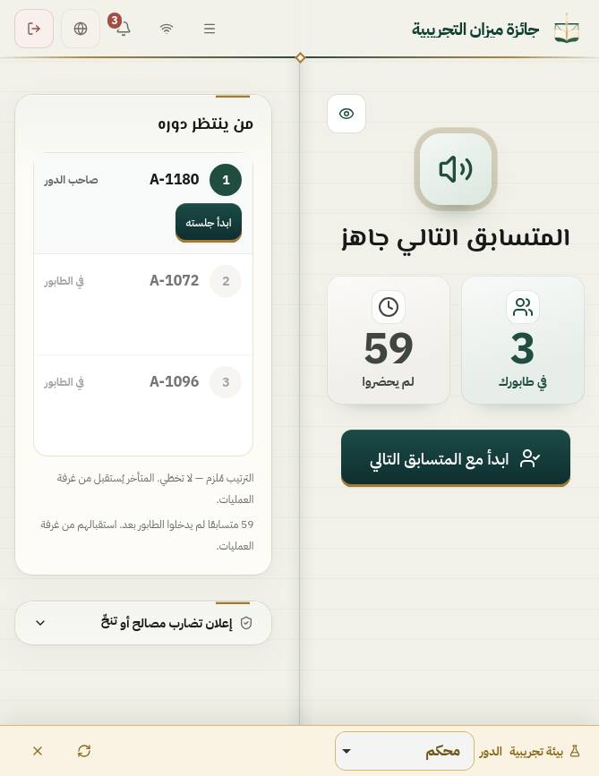 |
| انتظار المحكّم 951×585 | 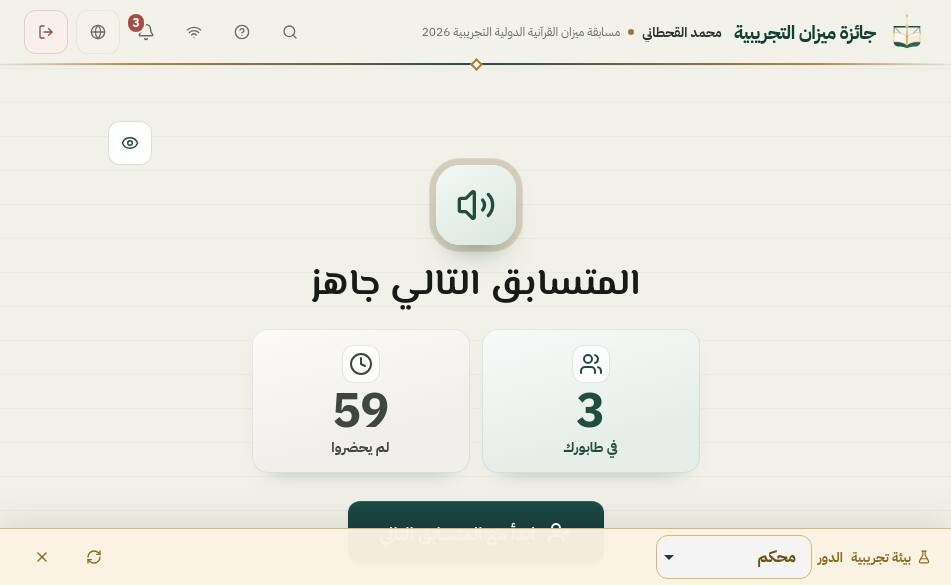 | 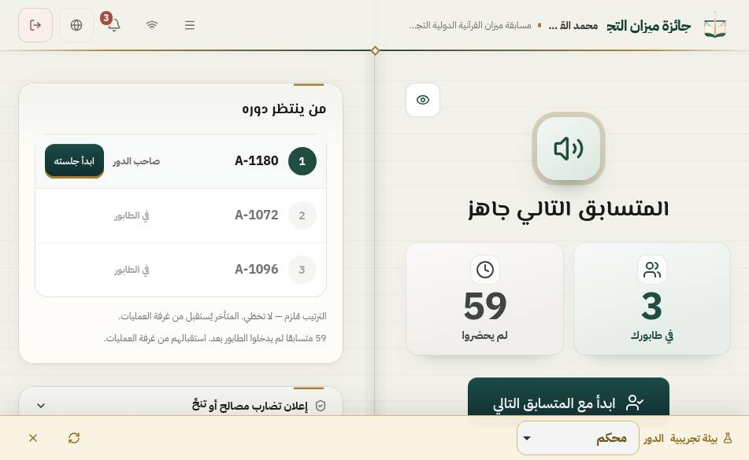 |
| مدير المسابقة 669×867 | 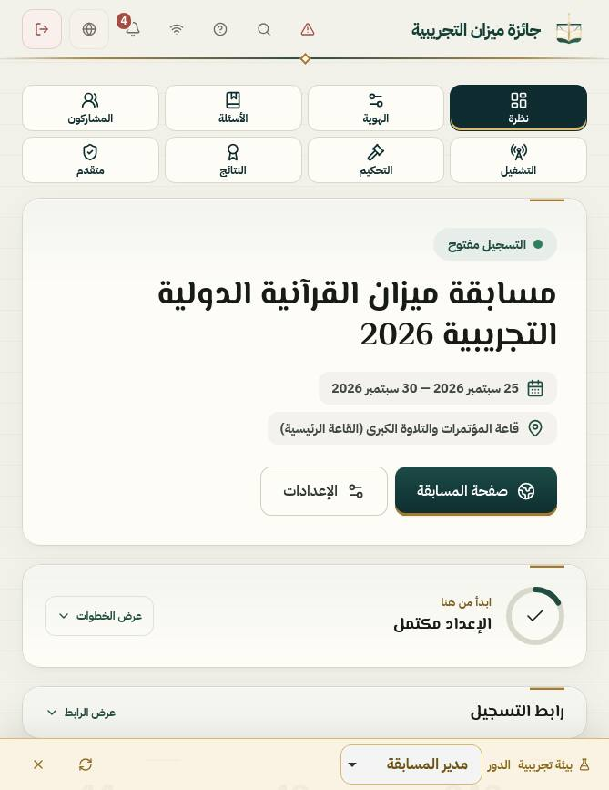 | 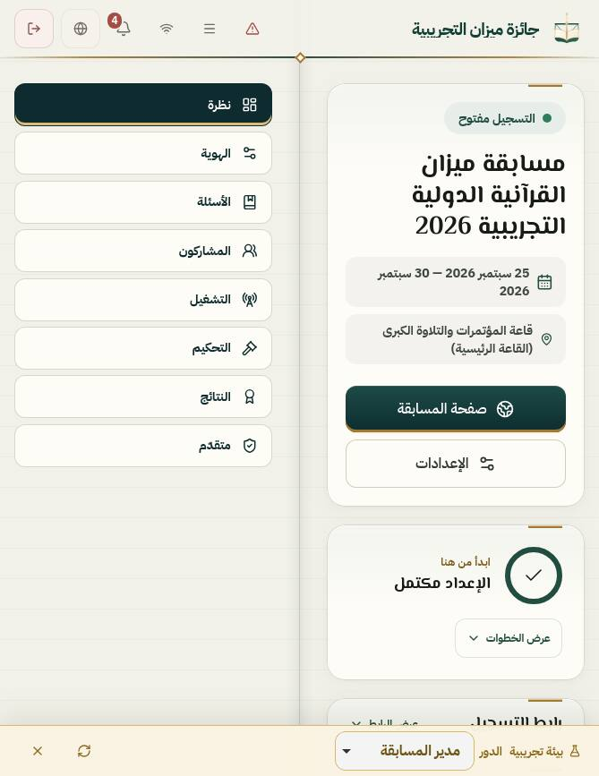 |
| مدير المسابقة 951×585 | 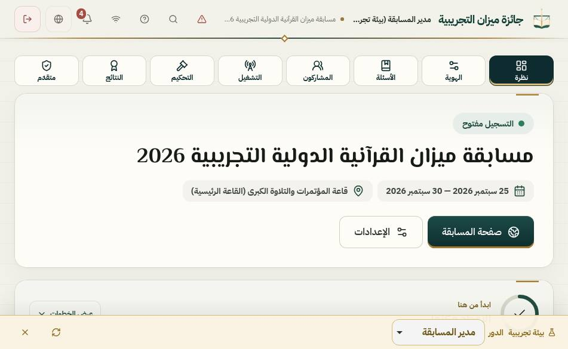 | 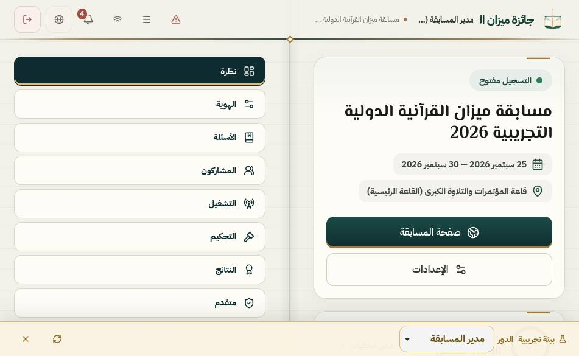 |

بعد فقط: [المتسابق 669×867](iphone-duo-final/after-participant-669x867.jpg)، [قمرة المحكّم 951×585](iphone-duo-final/after-judge-cockpit-951x585.jpg)، [حاسوب محمول: المتسابق 951×350](iphone-duo-final/after-E-laptop-participant-951x350.jpg)، [حاسوب محمول: رئيس التحكيم 600×350](iphone-duo-final/after-E-laptop-head-judge-600x350.jpg)، [مطويّ عرضي: المشاركون 594×368](iphone-duo-final/after-B-outer-landscape-participants-594x368.jpg)، [مطويّ: انتظار المحكّم 382×580](iphone-duo-final/after-A-outer-judge-wait-382x580.jpg).

## 10. الفحوص

| الفحص | الأساس | بعد |
|---|---|---|
| `npm run lint` (`tsc --noEmit`) | PASS | PASS |
| `npm test` | (CI أخضر على main) | 2884 نجح، 0 فشل (منها 5 جديدة في `duo-book-spread.test.ts`). `quran-tayseer-resegmentation` المذكور سابقًا نجح هذه المرة |
| `npm run build` | PASS | PASS |
| `secret-scan`، `source-audit`، `production-audit`، `arabic-ui-audit` | — | PASS (14/14 للعربية) |
| `qa-gate-wait-conditions` | — | PASS: سكربت الفحص لا ينتظر «هدوء الشبكة» |

## 11. قائمة المالك على الجهاز الحقيقي

1. افتح الجهاز كتابًا (طوليًّا ثم عرضيًّا) في Safari: الدخول، وانتظار المحكّم، ومدير المسابقة، والمتسابق. لا شيء على خطّ الطيّ، والصفحتان متوازنتان.
2. قمرة المحكّم مع مسابقة تُلزم بالتسجيل: ابدأ التسجيل، ثم اطوِ وافتح وانتقل إلى Split وعُد. يجب أن يستمرّ التسجيل وأن يُحفظ الملف كاملًا.
3. وضع الحاسوب المحمول (النصف السفلي مسنود): شريط الأقسام/التبويبات أسفل الشاشة تحت الإبهام، ولا يغطي آخر سطر بعد التمرير.
4. إن فُعّل علم Viewport Segments: هل يقع الكعب المرسوم على المفصل تمامًا؟
5. حجم النص الكبير في إعدادات iOS على الصفحتين.
6. حواف الأمان الفعلية حول الكاميرا في الشاشتين.

## 12. الجزء الثاني (بعد دمج #422)

- **مرساة التبويب في وضع الحاسوب المحمول** (ملاحظة مراجعة Codex على #422): شريط تبويبات غرفة القيادة صار يثبت أسفل الشاشة في 951×350، وكان هو نفسه مرساة `useTabAnchor(consoleTab)`. الخطاف يحسب `scrollY + rect.top − 96`، وموضع الشريط الثابت أسفل الشاشة يجعل هذا الحساب يتوقّف دون أن يمرّر. فكان تبديل القسم بعد التمرير يترك المستخدم في منتصف القسم الجديد. **الإصلاح (عرضٌ فقط)**: المرساة الآن عنصرٌ في التدفّق، بلا ارتفاع ولا هامش، قبل الشريط مباشرةً (`.mz-tab-anchor` في `RolePortals.tsx`). موضعه هو موضع الشريط في التخطيط العادي، فلا يتغيّر السلوك على الهاتف والحاسوب، ويبقى صحيحًا حين يثبت الشريط. وفي الكتاب لا تلتصق ورقة السياق التي فيها المرساة. **قيس في WebKit**: بعد التمرير إلى آخر الصفحة ثم تبديل القسم، يعود الموضع إلى أول القسم في 951×350 و669×867 و1280×800 و390×844، وإلى أقصى ما يسمح به القسم الجديد حين يكون أقصر.
- **CodeQL (`js/clear-text-storage-of-sensitive-data`) في `useJourneyReveal.ts:46`**: التدفّق المبلَّغ عنه قديم ولا يأتي من هذا العمل. `BillingPanel` يمرّر `summary.overdueInvoices` في `label` لمكوّن `Metric`، و`Metric` يبني مفتاح الحركة `metric:${label}` الذي يُحفظ في `sessionStorage`. السطور الثلاثة موجودة على `main` منذ `6fc3129` و`97acef2` (15 أكتوبر). ولا يغيّر #422 ولا هذا الجزء أيَّ تعبير `playKey`، ولا `Metric`، ولا `useJourneyReveal`، ولا مصادر الفوترة. وCodeQL نفسه نبّه إلى أن «تنبيهاتٍ لم يُدخلها الطلب قد تظهر لأن التغيير كبير». لم يُغلَق التنبيه ولم يُخفَ.
- **موضع التمرير عند الخروج من الكتاب** (وُجد في هذا الجزء): في WebKit بسياق لمس، كان الانتقال من الكتاب إلى أي مقاسٍ آخر (669→470، 951→470، 669→620) يعيد صفحة «المشاركون» الطويلة إلى أعلاها (240 ← 0). السبب: احتواء الأوراق (`container-type`) كان يُضاف ويُزال مع المقاس. وثبّت الاحتواءَ في كل المقاسات لم يحلّ المشكلة، بل زادها. **الإصلاح**: أُزيلت استعلامات الحاوية كلها، وصارت قواعد الورقة الضيّقة مقيّدةً بمقاس الكتاب نفسه وبالأوراق. بعده بقي الموضع 240 في الانتقالات الأربعة. أما الصفحات القصيرة (المتسابق، انتظار المحكّم) فيُعيد WebKit تثبيتها بحسب المحتوى، وهو السلوك نفسه على الأساس `2c4698a` (المتسابق 470 ← 355، والمحكّم 560 ← 409 هناك).
- **تغطيةٌ أوسع**: قمرة المحكّم ببوابة الموافقة، ثم بالموضع مفتوحًا (في ذاكرة بيئة العرض فقط، لا يُكتب شيء). والضغط (J) يغطي الآن 8 شاشات بدل 4. وصار سكربت الفحص يكتب تقريره وإن تعثّرت إحدى مراحله.

## 13. دوو ≠ آيباد (2026-11-14)

قرار المالك: وضع الكتاب (الصفحتان والكعب) يعمل على الشاشة الداخلية لآيفون دوو **وحدها**. استعلامات الكتاب الثلاثة في `src/index.css` (القسم 3) صارت مقيّدة بـ `screen`، وعرض الطولي الأقصى **720px** (كان 759.98 فكان يطابق iPad mini بعرض 744px، طوليًّا بارتفاع 1040 و1133)، والعرضي الأقصى 1000px كما كان.

| الاستعلام | المدى القديم | المدى الجديد | طابق آيباد؟ |
|---|---|---|---|
| الكتاب الطولي (القسم 3، الأوراق الضيّقة، الورقة الأضيق) | 640–759.98 × ارتفاع ≥ 520 | `screen`، 640–720 × ارتفاع ≥ 520 | نعم قبل: 744×1133 و744×1040. لا بعد |
| الكتاب العرضي | عرضي، 640–1000 × 520–720 | `screen` + العرضي، المدى نفسه | لا (آيباد العرضي ≥ 1024) |
| الحاسوب المحمول/القصير (ارتفاع ≤ 480، عرض 560–1023.98) | بلا تغيير | بلا تغيير | لا (أقصر آيباد 1024×690) |
| المفصل (`horizontal/vertical-viewport-segments: 2`) | بلا تغيير | بلا تغيير | لا (لا يُعلَن إلا حيث يوفّره المتصفح) |

القياس في WebKit (`scripts/duo-final-audit.mjs --sizes=...`، ويعيد الآن علامات الوضع لكل مقاس) على: الدخول، انتظار المحكّم، المتسابق، نظرة المدير، رئيس التحكيم، نافذة «اشرح لي هذه الواجهة». مقاسات الآيباد كلها (744×1133، 768×1024، 810×1080، 820×1180، 834×1112، 834×1194، 1024×1366 وعرضيّاتها، ومع شريط Safari: 744×1040، 768×920، 768×950، 810×990، 820×1090، 834×1020، 1024×690، 1133×660، 1180×735): الكعب `none`، و`.mz-spread` كتلة بعمود واحد، والشريط السفلي والتبويبات وورقة السياق `static`. أي تخطيط الجهاز اللوحي السابق. ومقاسات دوو (669×867، 669×520، 660×800، 700×900، 720×900، 951×585، 880×585، 1000×600): الصفحتان والكعب قائمان. أُخذت القراءة بعد انتظار استقرار البيئة التجريبية (قبل الاستقرار قد يظهر لحظةً شعار الترويسة فوق الكعب، وهو السلوك نفسه على `main`). حارس مصدري في `tests/duo-book-spread.test.ts` يفشل إن سمح استعلام كتاب طولي بعرض > 720 أو عرضي > 1000 أو لم يكن مقيّدًا بـ `screen`.

**قيد معروف**: نافذة Split View / Slide Over على الآيباد بعرض ~640–720px لا تُميَّز عن دوو بالمقاس. الفارق الحقيقي الوحيد هو `(horizontal-viewport-segments: 2)` ولا يعمل إلا حيث يعرضه المتصفح، ولم نلتفّ حوله. لم يُختبر على جهاز حقيقي.

## 14. ركن الودجت (2026-11-14، الجزء الثالث)

على الجهاز الحقيقي يطفو في أعلى اليمين **الفيزيائي** عنصرُ نظامٍ ثابت (كبسولة المصباح + الحساب/الموقع + الوقت + البطارية/الواي فاي) ليس جزءًا من safe-area. الموقع RTL، فهذه الزاوية هي بداية السطر: أسوأ مكانٍ لشعارٍ أو عنوانٍ أو أول زر. القياس من لقطات المالك: عرض ~58–64pt، بُعد ~6pt عن الحافة (وفي لقطة التطبيق ~17px)، وارتفاع ~180–200pt (≈30% من الارتفاع).

### السبب الجذري (من الكود، لا تخمين)

كانت هناك محاولةٌ سابقة (#429: `--duo-cutout-w/h = 116px` في `src/index.css`). لماذا لم تكفِ:

1. **الشرط ضيّق**: كتلتان فقط: الكتاب العرضي (721–1000 × 520–960) والطولي بعرض **640–720 وارتفاع ≥ 520**. فخرج منها **المطويّ 382×580 و470×780** (العرض < 640) و**594×368** (الارتفاع < 520)، وهي الوضعيات التي صوّرها المالك. في كل هذه كانت المنطقة صفرًا.
2. **الأبعاد خاطئة**: 116×116 بينما المقدَّر ~96 عرضًا و~31% من الارتفاع (حتى 270) طولًا، فيبقى النصف السفلي من الودجت فوق أول بطاقة.
3. **السطوح ناقصة**: غُطّي الهيدر الرئيسي والدخول والنوافذ فقط. بقيت دُرج «اشرح لي»، وصفحات المسابقة العامة والتسويقية (ترويساتها `sticky` بلا `.mz-el-header`)، وبقية الطبقات الثابتة بملء الشاشة، ومقبض قفل الجهاز الخفيّ (`fixed top-0 right-0`، تحت الودجت تمامًا).
4. **الـcascade**: في الكتاب العرضي تضبط قاعدة الكتاب `.mz-el-header > div:first-child{ padding-inline:var(--duo-gutter) }` بخصوصيةٍ أعلى من قاعدة الحشوة، فتُسقط الحشوة ويبقى الشعار تحت الودجت (لقطة 951×585 قبل الإصلاح الأخير). الحلّ: ذكر المحدِّد نفسه في قاعدة الودجت (لا `!important`).
5. اعتمدت القاعدة القديمة على `margin-right` للعنصر الأول/الأخير حسب `dir`؛ صارت `padding-right` فيزيائية على صفّ الترويسة، فلا تتبدّل بتبدّل الاتجاه ولا تعتمد `inline-end`.

الشرط **لا** يعتمد على `display-mode` ولا على `navigator.standalone` ولا على User-Agent ولا على ارتفاعٍ ضيّق، فيعمل في Safari وفي التبويب وفي الشاشة الرئيسية وفي غلاف Capacitor (انظر 14.5).

### 14.1 القياسات (تقدير من لقطات، لا قياس جهاز)

المصدر الوحيد `src/index.css`، قسم «ركن الودجت». **هذه أرقامٌ مقدَّرة من لقطات المالك داخل التطبيق، وليست قياسًا على جهاز.**

- **معايرة المقياس**: أزرار الدائرة القياسية 44pt تقيس ≈130px في لقطات بعرض 1348px ← ≈2.95px لكل pt ← نافذة التطبيق ≈ **457×678** بكسل CSS (استنتاجٌ، وليس من «المقاسات المعروفة»).
- على هذا المقياس: عمود الودجت عرضه ≈54pt ويبدأ ≈20pt من الحافة اليمنى (حدّه الأيسر ≈75pt منها)، وأعلاه ≈20pt وأسفله ≈166pt (مع حلقة البطارية).
- قياسٌ مستقلّ في مستودعٍ آخر (Dr.Ahmad #247) يقترح ≈80px عرضًا من 30 إلى 110 من الحافة ويصل y≈268 (ربما من مقاسٍ أو حالةٍ أخرى). **فالمدى غير مؤكَّد: 84–112px عرضًا و174–270px ارتفاعًا.**

| المتغيّر | القيمة | الدور |
|---|---|---|
| `--duo-widget-w` | `96px` | عرض المنطقة من الحافة اليمنى الفيزيائية (يغطّي 75pt + فسحة وجزءًا من قياس #247) |
| `--duo-widget-gap` | `8px` | فسحة بين المحتوى والمنطقة |
| `--duo-widget-h` | `clamp(64px, 31vh, 270px)` | الارتفاع (≈31% بحدّ 270) |

الثلاثة `0px` افتراضيًّا (أول `:root`)، فلا أثر لها خارج الجهاز. المنطقة = `x ≥ vw − widget-w` و`y ≤ widget-h`.

**المعايرة على الجهاز**: `?duo-debug=1&duo-w=110&duo-h=270` تُبدّل المتغيّرين مباشرةً (فقط مع `duo-debug=1`). عدّل `duo-w`/`duo-h` حتى يغطي الإطار الأحمر الكبسولة كلها، وأرسل لقطةً بالإطار؛ ثم تُثبَّت القيم النهائية في مكانٍ واحد في `src/index.css`.

الشرط **عامٌّ بلا عروضٍ مضبوطة** (كتلةٌ واحدة تحمل المتغيّرات والقواعد معًا):

- طولي بعرض ≤ 700 وارتفاع ≥ 360 (أيّ ارتفاعٍ أطول: التطبيق بلا أشرطة متصفّح). يشمل 382×580، 457×678، 470×780، 669×867، وتحققنا 430×932 و440×660 و480×720.
- عرضي 540–1000 بارتفاع 300–800 (594×368، 951×585، 780×470، 867×669، 669×520…).
- `horizontal-viewport-segments:2` و`vertical-viewport-segments:2` متى أعلنهما المتصفح.

**يلتقط هذا الشرطُ الهواتفَ العادية** طوليًّا (≤700) وعرضيًّا (مثل 667×375 و844×390)، احتياطًا آمنًا مطلوبًا؛ ثمنه أن ترويسة الهاتف العادي تنزل بارتفاع المنطقة. iPad (≥744 طوليًّا، ≥1024 عرضيًّا) والحاسوب خارجه. **هندسة العرضي لم تُتحقَّق على جهازٍ حقيقي.**

### 14.2 الجرد (ما انحجز)

| # | السطح | الملف / المحدِّد | ما فُعل |
|---|---|---|---|
| 1 | ترويسة التطبيق | `Header.tsx` ← `header > .h-16`, `.mz-el-header > div:first-child` | الصفّ بارتفاع المنطقة وحشوة يمين فيزيائية؛ الترويسة `relative` لا `sticky` |
| 2 | أدوات الترويسة (6 أزرار) | `.mz-el-header > .h-16 > :last-child` (≤700) | تلتفّ على سطرين داخل المنطقة بدل أن تُقصّ |
| 3 | ترويسة صفحة المسابقة العامة | `CompetitionLanding.tsx` (`header.sticky > .h-16`) | القاعدة العامة نفسها |
| 4 | ترويسة التسويق | `MarketingSite.tsx` (`header.sticky .h-16`) | القاعدة العامة نفسها |
| 5 | قائمة «المزيد» (قائمة جانبية منبثقة) | `.mz-el-header .mizan-more > div` | `absolute` تحت زرّها وتمتدّ يسارًا |
| 6 | الشريط العلوي للبثّ | `App.tsx` `.mz-topbar` | `padding-right` فيزيائي |
| 7 | تنبيه الخمول / الاستمرارية | `App.tsx` + `PersistenceAlert.tsx` `.mz-topnote` | `padding-right` فيزيائي |
| 8 | الدخول وMFA | `AuthPortal.tsx` `.mz-bp-login` | بدء البطاقة تحت المنطقة |
| 9 | صفحات البطاقة الواحدة (الخطأ…) | `App.tsx` `.mz-onepage` | `margin-top` بارتفاع المنطقة |
| 10 | النوافذ والإشعارات | `Modal.tsx` `.mizan-overlay` | تبدأ تحت المنطقة |
| 11 | البحث السريع | `CommandPalette.tsx` `.mz-palette-scrim` | تبدأ تحت المنطقة |
| 12 | درج «اشرح لي هذه الواجهة» | `ClarityGuide.tsx` `aside.mz-guide-sheet` | حشوة علوية بالمنطقة |
| 13 | الأسطح المثبّتة بملء الشاشة التي تُمرَّر أو توسِّط (نوافذ الإدارة، الإيصال، تحميل التطبيق) | `.fixed.inset-0:is(.overflow-y-auto,.overflow-auto,.grid)` | حشوة علوية بالمنطقة (لم تُقَس بالحارس كلها: انظر القيود) |
| 14 | شاشة البثّ | `.mizan-venue-deep` | حشوة بالمنطقة |
| 15 | شاشة الإقلاع | `.mizan-splash` | حشوة بالمنطقة |
| 16 | مقبض قفل الجهاز الخفيّ | `VenueLockControl.tsx` `.mz-venue-corner` | ينتقل إلى الزاوية اليسرى في Duo، ونصّ التعليمات (عربي/إنجليزي) يتبدّل «اليمنى/اليسرى» بـCSS (`.mz-corner-r/.mz-corner-l`) |
| 16ب | استعادة كلمة المرور | `PasswordResetPortal.tsx` `.mz-duo-top` | حشوة علوية بالمنطقة |
| 17 | صفحات الغلاف الأصلي (`apple/www/index.html`, `offline.html`) و`public/updating.html` | `<style>` | الشرط نفسه + حشوة علوية |
| 18 | الدخول الأصلي بالمحتوى المتوسّط/الخلفيات | — | لا يحتاج: خلفيات ملء الشاشة بلا محتوى تبقى حافةً لحافة |

لا يحتاج: `DemoBar` (أسفل الشاشة)، `AssemblyIntro` (`pointer-events-none` شفاف)، `WordMarkMenu` (ورقة سفلية)، مقبض القفل بعد النقل. شريط تثبيت PWA «أضف للشاشة الرئيسية»: **غير موجود في هذا الريبو** (لا `beforeinstallprompt` ولا لافتة) فلا شيء يُخفى.

### 14.3 الحارس الآلي

`npm run test:duo-widget` (يشغّل الخادم التجريبي بنفسه) ← [tests/duo-widget-corner.guard.mjs](../tests/duo-widget-corner.guard.mjs). Playwright **WebKit** (26.0، playwright 1.56.1، `--no-save` محليًّا لأن المتصفّح المثبّت هو الإصدار 1.56.1 بينما القفل يحدّد 1.63) على البيئة التجريبية المعزولة. لا يدخل في `npm test` ولا في CI عمدًا: يحتاج متصفّح WebKit وخادمًا (`playwright install --with-deps webkit` يفشل على ubuntu-latest الحالي). الجزء المصدري `tests/duo-widget-corner.test.ts` يعمل ضمن `npm test`.

ما يقيسه: لا نصّ مرئي (بمستطيلات أسطره) ولا `a/button/input/select/textarea/summary/[role=tab|button]/img/svg/canvas/شعار-خلفية` يتقاطع مستطيله (بعد قصّ الأب) مع المنطقة؛ ولا عنصر مهمّ خارج الشاشة؛ ولا تمرير أفقي. يُستثنى `data-duo-bleed` وزخرفة `aria-hidden` + `pointer-events:none`، وتُسجَّل الاستثناءات (لم يلزم أيٌّ منها). السياقات: **Safari** و**APP** (14.5). المقاسات: 382×580، 470×780، 594×368، 669×867، 951×585 وعرضيّاتها بتبديل w/h، + ارتفاعات التطبيق الكاملة 382×780، 382×844، 470×900، 669×1000، 951×700، ومقاس التطبيق المستنتج 457×678 و457×760؛ فاتح وداكن؛ نص 100% و200%؛ والسطوح: الدخول (غير مسجّل)، استعادة كلمة المرور، الخطأ، الدليل العام، الجواز، رئيسية مدير المسابقة، المشاركون، القائمة الجانبية مفتوحة، درج المساعدة، نافذة البحث، نافذة الإشعارات، المحكّم (انتظار + قمرة)، المتسابق، رئيس التحكيم، العمليات، الجهة، شاشة البثّ.

**النتيجة** (Safari + APP، WebKit 26.0 على playwright 1.56.1): **1944 خلية** (بعد إصلاح خلل في الحارس: أول نسخة كانت تقرأ `--duo-widget-h` بـ`parseFloat` فيعود NaN والارتفاع 0 فكانت النتيجة «0 مخالفة» **فارغة**؛ صارت المنطقة تُقاس بعنصر مسبار يحلّ `clamp()` فعلًا، ويفشل الحارس إن كان العرض ≠ 96 أو الارتفاع 0. المنطقة الفعلية: العرض 96 والارتفاع 114–270px حسب المقاس. ومعيار سلبي: على `a6f3d33` بالحارس نفسه 116 مخالفة صارمة في 3 أسطح فقط، فالحارس يكشف) = 18 سطحًا × 2 سياق × (10 مقاسات أساسية + 7 ارتفاعات تطبيق/457×678/457×760) × فاتح/داكن × نص 100%/200% (الارتفاعات الإضافية في الفاتح فقط). **صفر عنصر مهمّ داخل المنطقة الحقيقية في كل الخلايا** (نصّ/زرّ/حقل/تبويب/صورة/شعار)، وصفر استثناءات مسجَّلة، والمنطقة فعّالة بارتفاع >0 في كل خلية (`inactive=0`). الحارس الحقيقي كشف مخالفة واحدة بعد التصحيح: صفحة استعادة كلمة المرور (العنوان والفقرة تحت المنطقة)، أُصلحت بصنف `mz-duo-top` (`PasswordResetPortal.tsx`). **المخالفات الصارمة: 0** (تمريرٌ أفقي أو عنصر خارج الشاشة عند نص 100%).

- **استدراك صادق**: عند **نص 200%** (`html{font-size:200%}`) تبقى 496 خليةً فيها تمريرٌ أفقي أو عنصر خارج الشاشة؛ يصنّفها الحارس «تنبيهًا» لا فشلًا لأن الأساس يعاني منها أيضًا (على `a6f3d33` في المصفوفة نفسها: تمريرٌ أفقي عند 200% في 15 سطحًا). لم تُعالَج هنا لأنها ليست من ركن الودجت.
- **الأساس للمقارنة**: على `a6f3d33` بمنطقةٍ مفروضة (`--assume-zone`، قيمة أولية 70×clamp(30vh,200) في مصفوفة أصغر قبل المعايرة): **1322 من 1800 خلية** فيها عناصر تتقاطع (**3782 عنصرًا**، 18 سطحًا من 18)، وبعد العمل 0.
- أخطاء سُدّت أثناء العمل بفضل الحارس: أزرار الترويسة كانت تخرج يسارًا عند 382؛ قاعدة الكتاب كانت تُسقط الحشوة عند 951×585 (الشعار تحت الودجت)؛ قائمة «المزيد» كانت تخرج من الشاشة.
- تشغيل: `npm run test:duo-widget` (نحو 15 دقيقة).

### 14.4 الصور (قبل/بعد، مع إطار المنطقة الأحمر 96px × clamp(64px,31vh,270px))

| المقاس | قبل | بعد |
|---|---|---|
| 382×580 | 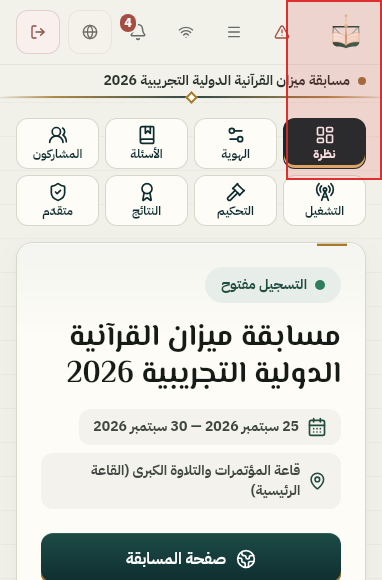 | 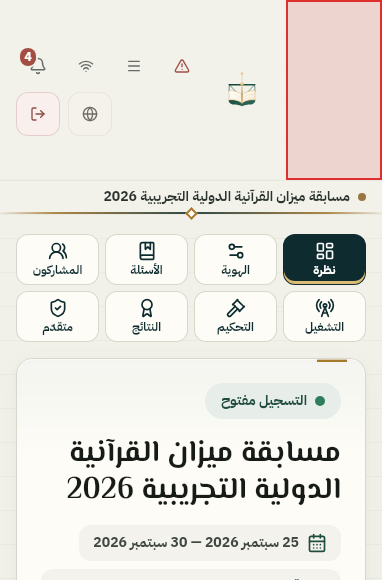 |
| 669×867 | 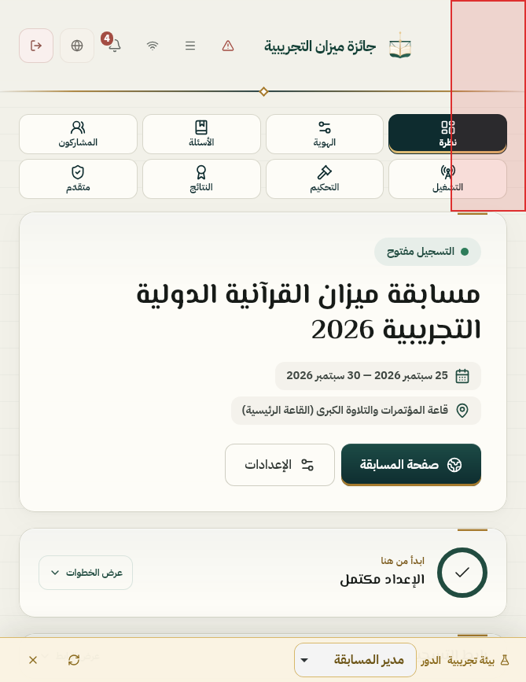 | 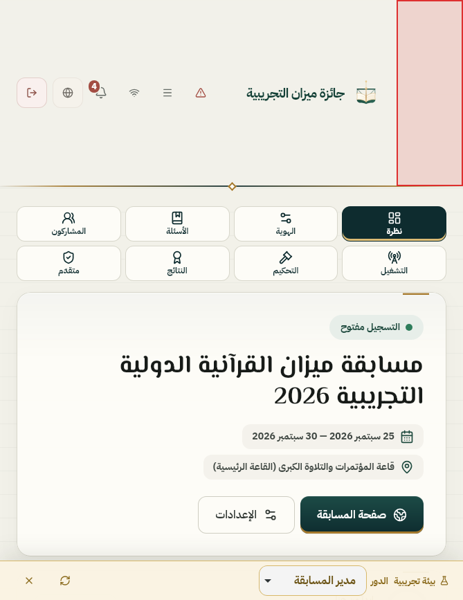 |
| 951×585 | 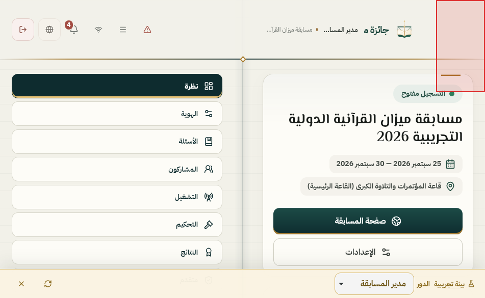 | 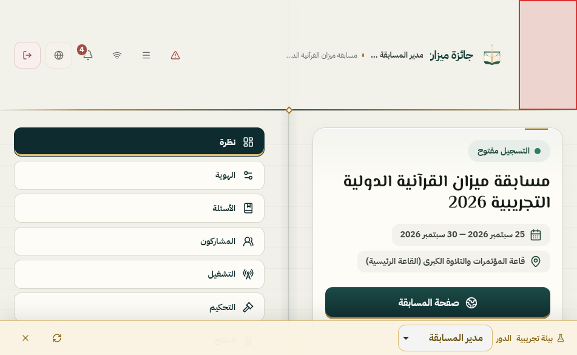 |

«قبل» = بناء محلي للفرع الأساسي `a6f3d33` (الموقع المنشور غير متاح من البيئة)، لقطات WebKit للشاشة الرئيسية لمدير المسابقة في البيئة التجريبية. ما رأيته في اللقطات: **قبل 382×580**: الشعار والأزرار والبطاقة الأولى تحت الإطار؛ **بعد**: الإطار فارغ والأدوات ملتفّة على سطرين يسارَه، والخلفية متّصلة خلفه. **قبل 669×867**: الترويسة مزاحة لكن تبويب «نظرة» والبطاقة الأولى تقع تحت الإطار الأطول (96×268)؛ **بعد**: الإطار فارغ كله. **951×585 بعد**: الشعار والأدوات يسار الإطار، والإطار فارغ؛ ثمنه ترويسة بطول المنطقة (~180px) في الكتاب العرضي. (الإطار مرسوم يدويًّا في اللقطتين بالقيم نفسها.)

### 14.5 التطبيق (Capacitor) مقابل Safari

الغلاف `apple/capacitor.config.json` يحمّل الموقع المنشور عبر `server.url` داخل WKWebView، مع `contentInset: "never"` و`viewport-fit=cover`، فتبدأ الصفحة عند y=0 تحت واجهة النظام وتكون `env(safe-area-inset-*)` صفرًا. الفروق التي تهمّ الكشف:

- User-Agent بلا `Safari/`؛ `navigator.standalone` غير معرّف؛ `display-mode: standalone` كاذب؛ `window.Capacitor` موجود.
- لا أشرطة متصفح، فالارتفاع **أطول** (382×780 بدل 382×580 مثلًا).

لذلك الكشف **CSS media queries فقط** على الاتجاه والعرض، ولا عروض مضبوطة، ولا بوابة ارتفاع ضيّقة (طولي ≤700 بارتفاع ≥360 مهما طال، وعرضي بارتفاع حتى 800). لا يوجد في الريبو CSS/JS خاصّ بالتطبيق (`appleNativeShell.ts` لا يغيّر العرض). صفحات الغلاف المضمَّنة `apple/www/*.html` ملحقةٌ بالشرط نفسه (البند 17).

يعمل الحارس في سياقٍ ثانٍ «APP»: `userAgent` WKWebView، `isMobile:true`، `deviceScaleFactor:2`، `window.Capacitor={isNativePlatform:()=>true,getPlatform:()=>'ios'}`، و`navigator.standalone` غير معرّف؛ ويمرّ على المصفوفة كاملة. **السياق مُحاكًى في WebKit سطح المكتب، وليس WKWebView ولا جهازًا حقيقيًّا**؛ على المالك التأكد بـ`?duo-debug=1` في TestFlight (14.6).

### 14.6 فحص المالك على الجهاز

1. افتح الموقع في Safari ثم التطبيق (TestFlight) وأضف `?duo-debug=1` إلى العنوان (مثلًا `https://mizan-quran.web.app/?duo-debug=1&duo-w=110&duo-h=270` للمعايرة؛ في التطبيق عبر رابط يفتحه الغلاف أو شاشة تقبل المعامل).
2. يظهر **إطار أحمر شفاف** في أعلى اليمين، ولوحةٌ سوداء صغيرة يسار الأسفل: `duo-widget active: YES`، قيم المتغيّرات، safe-area، المقاس، `dir`، standalone، `Capacitor: native ios`، وفحص UA.
3. تأكّد أن الإطار الأحمر **لا يغطي أي نصٍّ أو زرٍّ أو شعار**، في: الدخول، الرئيسية، القائمة الجانبية، نافذةٍ مفتوحة، طوليًّا وكتابًا وعرضيًّا. أرسل لقطة (ومنها إن كان الودجت الحقيقي يتجاوز الإطار الأحمر).
4. إن ظهر `active: no` على الجهاز فالمقاس خارج الشرط: أرسل المقاس من اللوحة.

**لم يُجرَّب شيءٌ من هذا على جهاز حقيقي.**

### 14.7 دخول Google داخل تطبيق iPhone

- **لا زرّ «الدخول بجوجل» ولا Apple في الريبو.** `grep` لـ`signInWithPopup|signInWithRedirect|GoogleAuthProvider|OAuthProvider|apple.com`: `src/lib/sso-signin.ts:1,16,19` (`signInWithPopup` ثم `signInWithRedirect`)، `src/components/auth/AuthPortal.tsx:2,94` (`OAuthProvider`/`SAMLAuthProvider` بمعرّف مزوّد تُرجعه `/api/public/sso/discover` حسب نطاق البريد)، `src/components/auth/TotpSecurity.tsx:25,33` (`reauthenticateWithPopup(user, new GoogleAuthProvider())` عند إعادة التحقق لحسابٍ مرتبط بـgoogle.com). لا شيء في `server*`.
- **الغلاف يفتح الموقع بـ`server.url`**: `apple/capacitor.config.json` ← `"server.url": "https://mizan-quran.web.app"`، و`allowNavigation` لا يتضمّن `accounts.google.com`. لا `UIApplication.shared.open` في المصدر المُرفَق، و`Info.plist` بلا `CFBundleURLSchemes` ولا `GIDClientID`.
- **الخطأ «Unable to process request due to missing initial state» موجود كخطرٍ فعلي** في المسارين اللذين يمرّان بمزوّد جوجل: (أ) الدخول الموحّد SSO إن كان مزوّد المستأجر Google Workspace (OIDC)؛ (ب) إعادة التحقق بجوجل في `TotpSecurity`. في WKWebView يُفتح تحويل الصفحة خارج التطبيق في Safari فتضيع حالة Firebase الأولية، وتحجب جوجل المتصفحات المضمَّنة (`disallowed_useragent`). الدخول بالبريد وكلمة المرور غير متأثّر. **لم يُعدَّل أي كود مصادقة.**
- **التوصية P0 (لا تُنفَّذ هنا)**: دخولٌ أصلي بجوجل:
  1. في `apple/package.json` أضِف `@capgo/capacitor-social-login`.
  2. أنشئ **iOS OAuth client ID** في Google Cloud (حزمة `com.dralfailakawi.mizan`) واحفظ الـ`reversed client id`.
  3. في `apple/ios/App/App/Info.plist` أضِف `CFBundleURLTypes` بالـURL scheme (reversed client id) و`GIDClientID`.
  4. في الويب (`src/lib/sso-signin.ts` و`AuthPortal.tsx`، و`TotpSecurity.tsx` لإعادة التحقق): إن كان `window.Capacitor?.isNativePlatform?.()` استدعِ `SocialLogin.login({provider:'google'})`، ثم `signInWithCredential(auth, GoogleAuthProvider.credential(idToken))`؛ وإلا المسار الحالي.
  5. `cd apple && npx cap sync ios`، ثم ابنِ/أرشِف نسخة iOS جديدة (`apple/apple-release.sh`) وارفعها إلى TestFlight.
  6. أضِف `accounts.google.com` إلى `allowNavigation` فقط إن بقي مسار الويب.

### 14.8 قيود صريحة

- لم يُجرَّب على جهاز Duo حقيقي ولا على WKWebView حقيقي؛ العنصر النظامي نفسه غير موجود في WebKit سطح المكتب، والحارس يفحص المستطيل المحجوز.
- هندسة العرضي غير مُتحقَّق منها على جهاز.
- الأسطح غير القابلة للوصول من البيئة التجريبية (نوافذ الإدارة والفوترة وشاشات القاعة العامة ومسابقة منشورة) غُطّيت بقاعدةٍ عامة (البند 13) لا بقياس.
- الشرط الطولي ≤ 700 يشمل هواتف iPhone العادية الطولية (يزيدها ارتفاعُ الترويسة).
- لا خطوة WebKit في CI (انظر 14.3).
